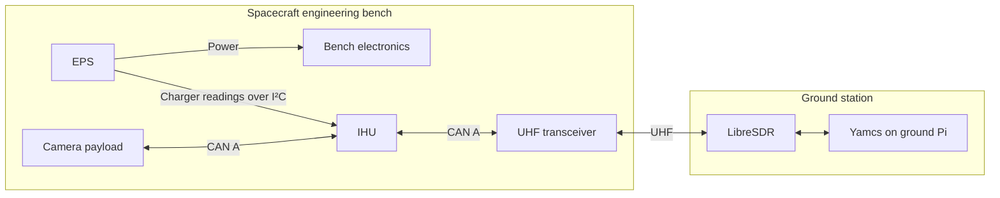

# EMBER

**Emission Monitoring for Burn Event Recognition** is a Mississippi State ECE
capstone project building a CubeSat-class wildfire detection instrument and
ground station. Its narrowband cameras look for the potassium emission
signature of flaming vegetation.

## System at a glance

The IHU coordinates camera fire checks and collects housekeeping telemetry.
The transceiver links the bench to Yamcs. Walter LTE-M is a separate telemetry
bench path.

## Hardware and firmware

Running versions are the latest recorded bench identities. Where a separate
development version is undocumented, the table gives the source version on `main`.

| Hardware | Revision or status | Bench firmware | Firmware development |
|---|---|---|---|
| [Electrical power system](hardware/eps/README.md) | Rev A prototype · Rev B in design | IHU reads the charger over I²C | Rev B STM32 supervision planned |
| [Solar panel](hardware/pv_panel/README.md) | Rev D design and release files | — | — |
| [Housekeeping computer](hardware/ihu/README.md) | RP2040 CAN Feather prototype | IHU `0.28.0` | `main` `0.28.0` |
| [UHF transceiver](hardware/comms/README.md) | Y24 prototype with original Pico | Transceiver `0.38.0` | `main` `0.38.0` |
| [Camera payload](https://github.com/ngrabbs/koenig_wildfire) | Three-camera prototype on Pi 4 | Payload `0.7.1` | `main` `0.7.1` |
| [Jetson carrier](hardware/payload_compute/README.md) | Next prototype in design | — | — |
| [Walter LTE-M bench](ground/lte/README.md) | CAN Feather and Walter modem | Last recorded `0.8.0` Feather · `0.3.0` Walter | `main` `0.14.1` Walter MCU · `0.3.0` Walter |
| [Ground station](ground/README.md) | Pi 5 and LibreSDR bench | Yamcs and EMBER ground software | [Ground releases](ground/releases/README.md) |
| [S-band transmitter](hardware/payload_exp_sband_tx/README.md) | Experimental FPGA bench | FPGA test designs | [FPGA work](hardware/payload_exp_sband_tx/fpga/README.md) |

[Hardware directory](hardware/README.md) · [Firmware builds and commit IDs](firmware/README.md#current-bench-builds) ·
[Radio guide](docs/comms/README.md) · [System architecture](docs/architecture/README.md)

## Team

Austin Burris (Housekeeping), William Ball (Power), Nick Grabbs
(Communications), Dustin Johnson (Command & Telemetry), and Jacob Timmons
(Payload).

Advisors are Dr. Dillon Boyd and Dr. Keith Koenig.
