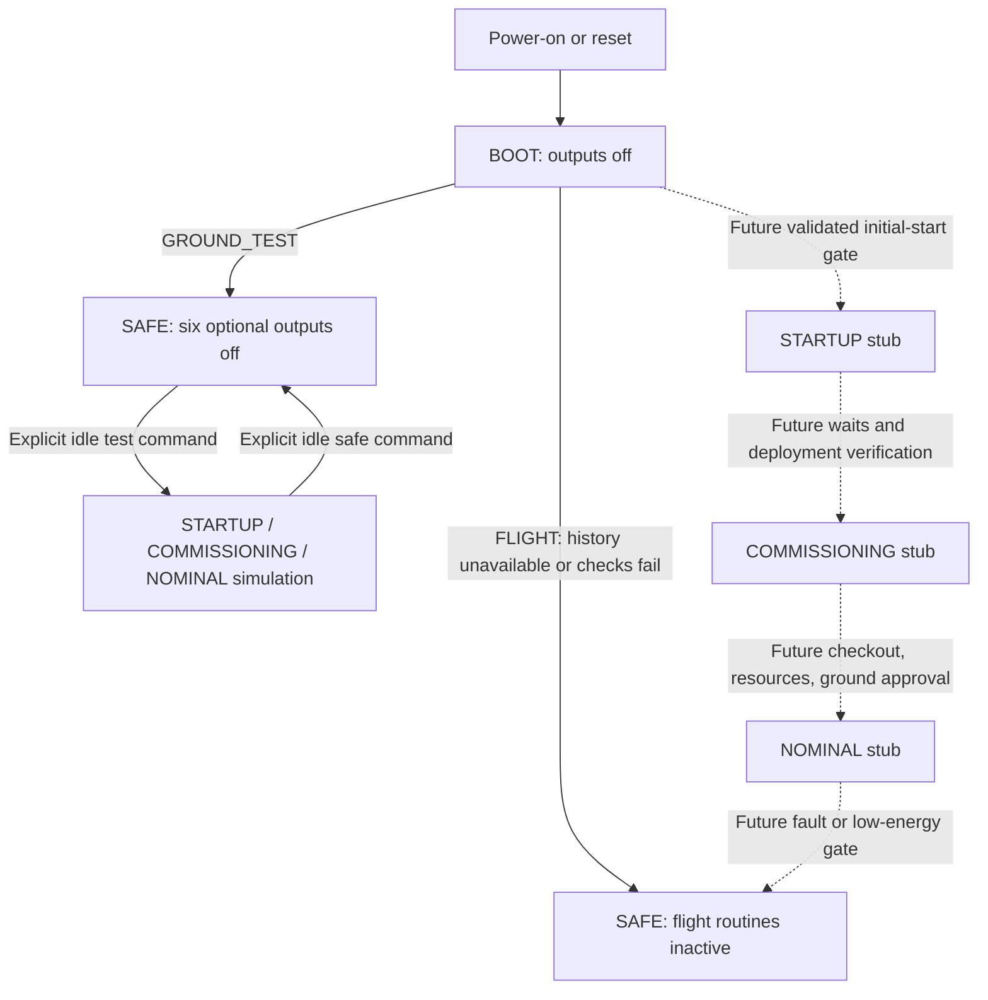

# IHU runtime modes and output policy

Source candidate: IHU CAN Feather **0.15.0**, serial bench bridge **0.4.0**.
The IHU now uses [FreeRTOS service tasks](../../firmware/rtos_design.md) with
one application owner for mode/protocol state. Hardware acceptance is pending;
the older deployment records below do not qualify the new scheduler.
This is the approved ground-test cleanup. Flight operations remain inactive
stubs; the flight requirements in the other three tables remain a draft.
This policy applies to the active application in `firmware/ihu`.

## Configuration and entry matrix

Configuration is selected at build and latched on reset. The default is
GROUND_TEST. `-DIHU_FLIGHT_CONFIGURATION=ON` builds FLIGHT; no physical
configuration-jumper pin has been assigned. IHU JP1 remains a watchdog jumper.

| Configuration | Mode | Runs automatically | Payload / deployment | Entry gate |
|---|---|---|---|---|
| Both | BOOT | Hardware initialization; safe output defaults; CAN readiness check | No automatic operation | Power-on or reset |
| GROUND_TEST | SAFE | Essential health sampling, addressed command handling, volatile fault recording | Explicit bench checks only; no automatic deployment | Default after BOOT, with boot-check result reported |
| GROUND_TEST | STARTUP | Simulation stub only | No real deployment | Explicit `mode startup` while application transport is idle |
| GROUND_TEST | COMMISSIONING | Checkout stub only | Individual commanded checks | Explicit `mode commissioning` while idle |
| GROUND_TEST | NOMINAL | Scheduler stub only; no automatic mission routine | Explicit bench checks only | Explicit `mode nominal` while idle |
| FLIGHT | STARTUP | Inactive release/wait routine stub | No actuator implementation | Intended: essential checks, validated history, first startup incomplete |
| FLIGHT | COMMISSIONING | Inactive checkout stub | No automatic operation | Intended: required waits complete and deployment verified |
| FLIGHT | SAFE | Read-only health sampling and diagnosis | No payload/deployment commands | Invalid/unavailable history, failed essential checks, or established-flight reboot |
| FLIGHT | NOMINAL | Inactive mission scheduler stub | No automatic operation | Intended: checkout passed, healthy resources and ground approval |

The runtime currently has no qualified persistent flight-history provider.
Therefore a FLIGHT build boots to SAFE with HISTORY_UNAVAILABLE (or a failed
CAN readiness reason), refuses active test commands and refuses every output
ON request. It does not offer an override that pretends flight gates passed.
Flight SAFE exits, power/thermal thresholds, release qualification, deployment,
recovery dwell and ground approval are reserved for the flight implementation.
GROUND_TEST mode changes are simulations; they never update flight history.
Every accepted mode change clears all six output switches and stops the UHF
producer. Busy mode changes are refused rather than interrupting an unknown
application transaction. Reset always re-enters BOOT and clears the switches.



## Six independent switches

All default OFF in GROUND_TEST SAFE and simulated modes. There is no enable-all
command. These control streams, not reception or a solicited command response.

| Switch | ON permits | OFF behavior |
|---|---|---|
| cli_debug | Human-readable asynchronous diagnostic lines, tagged CLI_DEBUG | No unsolicited CLI diagnostics |
| cli_telem | Human-readable health summary approximately every 5 seconds when idle | No periodic human-readable summary |
| umb_debug | Asynchronous wired diagnostic lines tagged UMB_DEBUG | No unsolicited wired diagnostics |
| umb_telem | Structured `ihu-health-v1` summaries and the host's periodic EPS forwarding | No periodic structured summary or bridge EPS forwarding |
| uhf_telem | Explicit bounded UHF telemetry submissions/runs | Refuse new UHF telemetry; stop its producer and unsent fragments |
| lte_telem | Explicit LTE telemetry packet submission | Refuse new LTE telemetry and stop unsent fragments |

CLI and umbilical are distinct logical formats sharing the existing USB CDC
console on this Feather. Enabling both debug formats produces both tagged
copies. This release does not wire another physical UART or allocate new pins;
UART is a future transport alternative, not a newly enabled port.

The switches are permissions: RF ON does not start a telemetry run, a modem
window or a ground receiver. With transceiver 0.33.0, healthy idle CAN accepts IHU
UHF requests without a transceiver console window. Each accepted request uses
bounded RF bursts, reports a local result, then returns to muted idle CAN.
Normal CAN, fresh HELLO, route selection and idle-work checks still apply.
LTE windows and ground RF command receive/reply sessions remain explicit.
Already admitted remote RF packets may finish after OFF. A switch cannot
recall a packet already accepted by another processor.

## Minimal console

Commands are case-sensitive; each must be a complete literal line.

```text
mode
outputs
output cli_debug on
output cli_telem on
output umb_debug on
output umb_telem on
output uhf_telem on
output lte_telem on
output uhf_telem off
mode nominal
mode safe
faults
```

`mode` reports configuration, mode, simulation flag, inactive flight routines
and entry reason. `outputs` reports all six effective flags. Unsupported names,
extra arguments and `output all on` are rejected. `mode boot` is rejected;
a real reset is required. `mode nominal` in GROUND_TEST remains a simulation.
Explicit status, help, observation and correlated command replies remain
available with all streams OFF, including asynchronous CAN results and RF
fire-check results. RF command replies still require the separately bounded
transceiver receive/reply window; they do not enable periodic UHF telemetry.

The retained explicit diagnostic commands cover CAN HELLO/ping, EPS JSON/ADC,
payload checks, LTE status/identity/diagnostics and bounded RF work. Retired
from this application: `telemetry`, `eps telemetry`, `telem on/off/status`,
`eps enqueue` and `lte queue ...`. Their historical helpers/evidence remain
for reference, but the runtime has no legacy timer or LTE queue pump.

For exact packet inclusion/exclusion and pacing across links, use the
[transmission matrix](../../user/ihu-can-console.md#transmission-matrix).

## Sampling, reporting and fault history

Internal EPS readout is sampled approximately every 5 seconds while transport
is idle, regardless of output flags. A failed full read invalidates the cache;
its transition records a fault. Discovery visits one of five entries every
2 seconds when idle (roughly 10 seconds per cycle). EPS discovery uses the
housekeeping sample instead of a second register-read task. Radio/application
work defers sampling and discovery; rates are best effort, not deadlines.
Presence discovery is not detailed subsystem telemetry or a valid battery
measurement. CLI/umbilical summaries retain EPS validity/sample time and
transceiver/LTE/payload discovery states. The existing EPS JSON/decoder retains ADC,
chemistry, cell-count and sense-resistor qualification rules.

The fault ring retains the latest 16 records in RAM: 1=essential CAN boot check,
2=EPS read failure transition, 3=CAN TX failure, 4=timeout/cancelled unsent
telemetry. `faults` is an explicit reply. History is not persistent and does
not implement flight recovery or power protection.

## Ground bridge and migration

Install IHU 0.14.0 together with bench bridge 0.4.0. With `--poll-eps`, the bridge
checks `outputs` approximately every 5 seconds between commands and reads/
forwards EPS only while umb_telem=1. OFF, an unknown policy or a policy-query
failure never falls back to streaming. Ground values then expire normally.
A manual `eps json` is still a solicited diagnostic reply. Other PAYLOAD_*
command/result transactions are unchanged. The bridge ignores interleaved
`ihu-health-v1` summaries when waiting for an LTC4162 JSON reply.

Before flashing, stop the exclusive bench bridge and preserve the previous
image. Reopen one console owner, confirm SAFE/GROUND_TEST and all outputs OFF,
then deliberately enable only the wanted channels. Existing RF command and
live telemetry services still require coordinated radio ownership.

IHU 0.13.0 and bridge 0.4.0 were deployed on m75q on 2026-10-17; see the
[deployment record](../../../system/ground_station/evidence/ihu-0.13.0-20261017/deployment.json).
Readback verification, quiet defaults, six switches, telemetry summaries, mode
reset, solicited EPS/payload replies and reboot defaults passed. All outputs
were left OFF with the bench bridge active. OFF during active RF work and a
new end-to-end RF regression remain untested for this release. Earlier 0.12.0
OTA records describe the earlier deployment.
