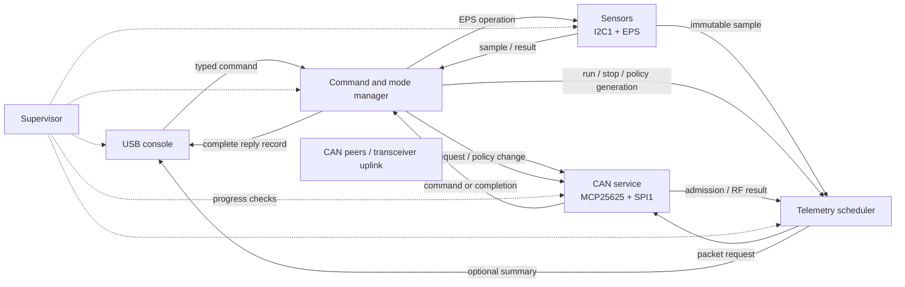

# IHU FreeRTOS migration plan

[Topic guide](README.md) · [Current IHU](../../firmware/ihu/README.md) ·
[Mode/output contract](../architecture/operations/04-ihu-runtime-policy.md)

**Proposal for review, 2026-10-17.** No RTOS firmware, new flight routine, or
hardware deployment is implemented by this document. The active IHU remains
Pico SDK firmware with a cooperative main loop. Recommend migrating IHU to
FreeRTOS with preemption on core 0, bounded queues, and explicit state ownership.
Keep core 1 unused initially. Retain the current `ihu` target and `ihu.uf2` name.

## Reference review: AMSAT rt-ihu

Reviewed the local tree at `/Volumes/work/AMSAT/rt-ihu`, HEAD
`004babf8d525775d2e35964f2e360c2f197b276e` (Add semaphore for ADCS).
The checkout has local changes: the examined task/kernel files mostly report
file-mode differences; `config.h` additionally selects LAUNCHPAD and deselects
V12. Findings describe inspected source, not a successful build or hardware
qualification. The reference tree was not modified.

| Reference evidence | What it does | EMBER decision |
|---|---|---|
| `main.c`, `tasks/src/*` | Separate CAN, command, telemetry collection, downlink control, radio, coordination, experiment and console responsibilities | Borrow the separation; start with six EMBER tasks below |
| `FreeRTOSConfig.h:93–104`, `FreeRTOS/inc/os_task.h` | FreeRTOS 8.2.0, **preemption OFF**, 100 Hz tick, 64 KiB RTOS heap | Use a pinned maintained upstream RP2040 port; propose preemption ON and a 1 kHz tick, subject to measurement |
| `Interfaces/src/interTaskNotify.c`, `intertaskMessageDefinitions.h` | Typed messages and destination queues; tasks wait for work | Use typed bounded messages, static allocation, and checked queue results |
| `tasks/src/TelemetryCollection.c` | Collection separate from downlink; maintains telemetry datasets | Separate EPS acquisition, immutable snapshots, and packet production |
| `tasks/src/DownlinkControl.c` | Event-driven state table, timers, separate radio task | Retain EMBER's tested UHF state machine and remote transceiver; no local radio task needed |
| `drivers/src/{canDriver,i2cDriver,spiDriver,serialDriver}.c` | ISR notifications, completion semaphores and bus mutexes | Adopt ownership/completion patterns; rewrite hardware integration for MCP25625/Pico SDK |
| `deviceSupport/src/watchdogSupport.c` | Tasks check in; a supervisor callback feeds watchdogs based on aggregate reports | Supervise meaningful task progress, including bounded idle waits; avoid unconditional feed loops |
| `main.c` startup, `Interfaces/src/nonvolManagement.c` | Console task initializes the application, reads MRAM history, waits after release and may deploy antennas | Use an explicit boot barrier; keep EMBER's current fail-closed history and inactive flight stubs |

[Reference source at reviewed commit](https://gitlab.amsat.org/engineering/golf/rt-ihu/-/tree/004babf8d525775d2e35964f2e360c2f197b276e).

This is an architectural review, not a full audit of rt-ihu. Its TI TMS570,
HALCoGen startup, big-endian ARM R4 build, dual-IHU coordination, MRAM, radio
hardware and spacecraft protocols are not drop-in RP2040 components.

Specific patterns to improve rather than copy:

- `NotifyInterTaskFromISR()` declares its wake flag without initializing it
  and does not request a scheduler yield in that wrapper. A new preemptive
  integration must initialize the flag and use the selected port's ISR-yield
  convention. The cooperative reference is not proof of preemptive correctness.
- Queues are created dynamically inside individual task startup routines.
  Create/check all required EMBER objects before enabling producers, avoiding
  sends to queues that do not yet exist.
- `TelemetryCollectTask()` reports a failed queue receive but subsequently
  examines the message. EMBER must not consume message fields after a timeout.
- Watchdog reporting uses a shared read/modify/write bitmask. Preemptive EMBER
  needs synchronized progress records; copying this unsynchronized pattern can
  lose updates. Do not use the reference's startup “everyone checked in” shortcut
  as steady-state liveness evidence.

## Why move this IHU

The current [main loop](../../firmware/ihu/main.c) serially handles CAN,
console commands, EPS reads, UHF production and discovery. `eps_readout.h`
uses synchronous I2C calls with individual 10 ms timeouts. A slow read delays
CAN processing. Current housekeeping also deliberately defers sampling during
radio/application work, so the five-second health period is best effort.

FreeRTOS lets CAN servicing preempt EPS or console work. It does not make the
MCP25625, shared protocol state, USB stack or I2C routines safe for simultaneous
callers. The migration is principally a separation of resource ownership.

## Proposed task and ownership matrix

Larger numbers mean higher priority; these are initial design values, not
measured scheduling guarantees. All tasks block when idle or work is deferred.
No high-priority task may spin indefinitely and starve the supervisor or idle.

| Task | Priority | Wake condition / cadence | Sole mutable state and hardware owner |
|---|---:|---|---|
| `supervisor` | 5 | Proposed 100 ms check; watchdog window set after measurement | Task progress/boot readiness, watchdog feed, reset diagnostics |
| `can_service` | 4 | RX notification and nearest TX/fragment deadline; bounded fallback polling | MCP25625/SPI1, CAN mode, fragments, pending CAN request, peer sessions, request IDs, UHF result trackers, discovery state |
| `command_mode` | 3 | USB/RF command or CAN/sensor completion | Mode, six output permissions, admission generation, command contexts, payload fire-check deduplication and orchestration, fault ring |
| `sensors` | 2 | Five-second health due event or explicit fresh EPS/ADC request | I2C1, EPS read/write/readback, EPS validity and sample timestamp |
| `telemetry` | 2 | Run/stop event, due time, sensor/CAN completion | UHF run state, packet sequence/readout counters, packet construction, stream scheduling |
| `usb_console` | 1 | Input available or bounded reply/log work | Application USB input parsing and complete output records; command routing context |
| Kernel idle | 0 | No ready work | Idle bookkeeping; no unconditional watchdog feed |

The RTOS tasks exist in every configuration. Application mode determines which
work is permitted; changing mode does not create/delete tasks. Flight STARTUP,
COMMISSIONING and NOMINAL remain inactive routines, and missing flight history
continues to select restricted SAFE.

## Message and resource rules

1. **One CAN owner.** Console, sensors and telemetry never call `mcp_*` directly.
   CAN status/selftest/normal become service requests. Preserve initial
   one-outstanding-application-transaction behavior and existing BUSY responses;
   a queue is not permission to run conflicting operations concurrently.
2. **Immutable request context.** Include source, reply destination, operation,
   target CAN route, expected peer boot, correlation token and deadline. Preserve
   the existing block on target switching while busy. Never let queued work use
   a subsequently changed global console target.
3. **Separate delivery from acceptance.** Internal enqueue success is not
   SUBMITTED, remote admission, RF completion, or ground receipt. Keep those
   outcomes distinct and retain existing CLI/wire responses. Reserve completion
   capacity before admitting work; full queues return BUSY or a defined fault.
4. **Single policy owner.** `command_mode` publishes a synchronized policy
   snapshot and generation. Check eligibility again at CAN submission and packet
   production. OFF revokes queued telemetry of that class, stops its producer,
   and cannot be undone by a stale queued ON/run event. Acknowledgement ordering
   must ensure no locally revocable work starts after OFF is acknowledged.
5. **Preserve reply exceptions.** Tag solicited command responses separately
   from optional telemetry. Disabling UHF telemetry must not discard the payload
   fire-check reply. Packets already admitted remotely may still finish.
6. **Bounded EPS service.** Every EPS JSON, telemetry read and ADC override goes
   through `sensors`. Preserve PEC and ADC/chemistry validity rules. Failed full
   reads invalidate the sample; attach request identity and sample time to every
   result. UHF EPS stages still request a fresh read, rather than silently using
   an old periodic cache.
7. **No cross-task printf.** Producers enqueue complete, bounded records; USB
   backpressure never blocks CAN or command completion. Reserve reply records
   separately from optional debug, count debug drops, and serialize entire
   JSON/CLI records. Audit Pico SDK stdio/TinyUSB IRQ and timer ownership for the
   pinned SDK; do not add a second `tud_task()` loop beside SDK servicing.
8. **No blocking timer callbacks or ISRs.** They notify a task, with checked
   return values and the port's correct wake/yield handling. No SPI, I2C, printf,
   application command execution, or waits inside them. Initially use task
   deadlines rather than adding software timers for every periodic operation.
9. **Copy or explicitly transfer ownership.** Queue messages contain values or
   handles into fixed pools with an explicit lifetime. Never queue pointers to
   temporary packet buffers. Snapshot publication must protect against torn
   structures; `volatile` is not synchronization.

Proposed starting queue capacities: four command/request entries per ingress,
eight reserved CAN completion entries, one coalesced periodic sample slot,
eight USB reply records and sixteen optional log records. Keep emergency
telemetry-revocation state outside a saturable bulk queue. These capacities
are sizing hypotheses: calculate worst-case message sizes, reserve actual RAM,
and validate overload and completion bounds before hardware deployment.

## Kernel, driver and boot decisions

- Pin an upstream kernel release/commit and RP2040 port alongside the tested
  Pico SDK/compiler identity. No floating branch dependency and no restoration
  of the removed TMS570 or EMBER prototype kernel. Start with one core; choose
  the supported port's single-core configuration during the build spike.
- Propose preemption enabled, 32-bit ticks, 1 kHz tick and tickless idle disabled
  initially. Preserve protocol timing with the existing monotonic milliseconds
  where needed; a 1 ms tick is not a guarantee of 1 ms CAN service latency.
- Statically allocate tasks, queues, pools and kernel service stacks; disable
  RTOS dynamic allocation. Check SDK/libc allocation separately. Record linker
  RAM use, stack high-water marks and queue occupancy under worst-case load;
  leave explicit measured headroom before choosing final stack depths.
- Keep assertions and stack-overflow checks in release configurations. Fault
  paths must work without USB, heap allocation or an operational logger.
- The current MCP driver configures GPIO inputs but disables MCP interrupts.
  First establish measured bounded polling. Qualify the existing board INT
  mapping and level/edge behavior before adding GPIO notification; enable the
  relevant MCP interrupt sources and drain pending RX/status until quiescent.
  Include a fallback deadline wake and a bounded drain budget. Do not assume
  1 kHz polling can absorb arbitrary 500 kbit/s traffic with two hardware RX
  buffers. Publish the tested traffic envelope and overflow behavior.
- Audit `mcp_mode()`'s up-to-100 ms synchronous wait. Convert runtime mode
  transitions to service states/deadlines before claiming CAN responsiveness
  during selftest/normal operations. Initialization may precede normal service.
- Initialize safe outputs and build identity, create/check all objects, start
  the scheduler, and wait on explicit readiness results. Use a finite boot
  deadline. Failed essential CAN initialization selects the existing SAFE
  reason; object/scheduler failure follows a bounded diagnostic/reset path.
- A supervisor feeds the watchdog only after required tasks show meaningful
  progress or a valid bounded idle wait. Do not mask a stuck transaction with
  arbitrary heartbeat calls. Establish startup grace, per-task deadlines and
  reset-loop behavior in tests. Qualify the RP2040 internal watchdog first;
  the external watchdog/JP1 behavior needs its own verified board interface.

## Preserve behavior first, then improve sampling

| Behavior | First RTOS release | Later change requiring separate review |
|---|---|---|
| Reset/mode entry | All six optional outputs OFF; current SAFE/GROUND_TEST default | None proposed |
| FLIGHT configuration | Missing history selects SAFE; active routines remain refused | Persistent history and qualified flight routines |
| Explicit commands | Current syntax, route checks, duplicate handling, timeout/result meanings | More simultaneous application transactions |
| EPS health/discovery | Keep existing five-second / two-second best-effort eligibility gates | Allow independent EPS sampling during RF work and publish freshness/deadline guarantees |
| UHF run | Same four packet stages, one in flight, result guard, finite duration, no catch-up/retry | Any new schedule or packet mix |
| UHF/LTE permission | Existing six switches and OFF cancellation semantics | No enable-all or automatic RF proposed |
| Telemetry packets/ground | Existing packet bytes, IDs, USB formats and Yamcs interfaces | Optional RTOS health telemetry in an independently versioned contract |
| Other applications | Walter MCU, Walter ESP32-S3, transceiver and payload unchanged | Separate migrations only if justified |

Hardware polling and periodic USB reporting should become separate operations:
a missing USB host must never prevent sampling or CAN handling. The first port
retains existing sampling eligibility deliberately, even though acquisition is
in a separate task. Removing that eligibility gate is a visible operational
change and should be measured and documented independently.

## Staged implementation and exit gates

| Step | Deliverable | Required exit evidence |
|---|---|---|
| 1. Baseline and module boundaries | Extract CAN, command/policy, EPS, telemetry and USB responsibilities under `firmware/ihu`; retain the current loop while splitting state ownership | Existing handler/codec/mode tests pass; traces and packet contents retain current behavior |
| 2. Kernel/build spike | Pin kernel; static single-core tasks, boot barrier, USB integration and failure hooks; retain `ihu` artifact naming | Fresh ARM GROUND_TEST and FLIGHT builds; scheduler/tick/IRQ ownership verified; no unwanted changes to other firmware builds |
| 3. Task conversion | Replace the loop with the six task adapters and typed bounded messages | Command correlation, BUSY/target rules, fresh EPS stages and OFF-versus-queued-work tests pass under injected interleavings |
| 4. Timing and supervision | Bounded CAN service, optional qualified INT wake, no blocking mode waits, progress supervision | RX latency/overflow and queue occupancy measured under combined traffic; stuck-task and scheduler-starvation resets verified |
| 5. Bench/RF regression | Install a versioned candidate with recorded previous-image backup and rollback commands | Quiet reset and mode changes, console disconnected/slow host, EPS timeout, CAN peer reset, UHF run/OFF, LTE status/send, payload fire-check, both bench and actual flight RF command/reply paths |
| 6. Acceptance and cleanup | Update user guide/runtime matrix, source/kernel/build identities and evidence index; remove temporary migration switches | Ground decode/archive checked separately from local RF completion; sustained run and reset/recovery evidence reviewed; no stale alternate firmware tree |

For step 4, define the supported CAN traffic/burst envelope and acceptance
latency before recording a pass. A useful initial test stimulus is concurrent
EPS timeout, USB log pressure, discovery and addressed CAN/RF replies. Record
worst observed interrupt-to-read and frame-to-dispatch times; relate them to
MCP RX capacity and protocol fragment deadlines. Include queue saturation,
tick/time wrap, lost wakeups, task stack exhaustion and long idle waits.
Use a minimum one-hour mixed-workload bench soak as an initial gate, followed
by a separately agreed endurance run; neither establishes flight qualification.

The first release can provisionally be IHU **0.15.0** after runtime behavior and
validation are ready. Do not bump Walter MCU, Walter, transceiver or ground
versions solely for this internal IHU scheduling change. Runtime metrics should
initially be solicited diagnostics; changes to shared packets need dictionary
and consumer updates as a separate compatibility decision.

## Technical sources

- [FreeRTOS scheduling](https://www.freertos.org/Documentation/02-Kernel/02-Kernel-features/01-Tasks-and-co-routines/04-Task-scheduling): priority-based preemption and single-/multi-core execution.
- [Official RP2040 port](https://github.com/FreeRTOS/FreeRTOS-Kernel/tree/main/portable/ThirdParty/GCC/RP2040): Pico SDK integration and port configuration; pin the chosen revision during implementation.
- [FreeRTOS software timers](https://www.freertos.org/Documentation/02-Kernel/02-Kernel-features/05-Software-timers/01-Software-timers): callbacks must not block.
- [Memory allocation](https://www.freertos.org/Documentation/02-Kernel/02-Kernel-features/09-Memory-management/01-Memory-management): static versus dynamic object allocation.
- [Pico SDK USB stdio](https://github.com/raspberrypi/pico-sdk/blob/2.1.1/src/rp2_common/pico_stdio_usb/stdio_usb.c): audit IRQ/timer servicing when integrating the kernel.

The previous EMBER FreeRTOS prototypes remain in
[Git history](https://github.com/ngrabbs/ember/tree/e133cf204a10ed47e703e5e5a81f17a4241268de/firmware).
They are references, not the source of the new hardware port.
