# IHU mode demo — Pico installation and walkthrough

This guide is for the IHU lead using the **original Raspberry Pi Pico or Pico H
(RP2040, non-wireless)**. The supplied file will be **`ihu_demo.uf2`**, demo version
**0.1.0**. You do not need the source code, a compiler, Python, or flight hardware.
The release package must include the hardware acceptance record before handoff.

This is a standalone teaching image using FreeRTOS and the IHU's mode names and
console conventions. It models the deployment sequence; it does not connect to
EPS, CAN, the payload, an antenna actuator, or a radio. All health, checkout,
antenna and RF results are explicitly simulated. The real IHU's flight routines
remain stubs; this demo is not a flight release or flight qualification.

## 1. Gather the parts

- Original Raspberry Pi Pico or Pico H, with header pins fitted.
- A **USB data cable** (USB to micro-USB), not a charge-only cable.
- A computer and serial terminal. Windows: PuTTY in Serial mode. macOS/Linux:
  `screen`, or an installed serial-terminal application.
- Breadboard and two removable jumper leads, plus a shared ground connection.
- The tested `ihu_demo.uf2` and its matching SHA-256/acceptance record from the team.

Pico 2, Pico W, and CAN Feather are not supported by this image. Installing this
UF2 replaces the application already on that Pico. Use the designated demo board.

## 2. Wire the two release switches with USB disconnected

Orient the Pico **component side up, USB connector at the top**. Physical pins
1–20 run down the left edge. The three pins used are near the bottom of that edge.
GPIO numbers and physical header-pin numbers are different.

| Demo input | GPIO name | Physical header pin | Connect to |
| --- | --- | --- | --- |
| Release switch A | **GP14** | **19** | Ground through removable jumper A |
| Release switch B | **GP15** | **20** | Ground through removable jumper B |
| Shared ground | **GND** | **18** | Ground rail for both jumpers |

```text
Pico, component side up; USB at top
Left edge, bottom three pins:

  pin 18  GND  ─────────── ground rail
  pin 19  GP14 ── jumper A ───┤
  pin 20  GP15 ── jumper B ───┘
```

1. Connect physical pin 18 to a breadboard ground rail.
2. Connect GP14 (physical pin 19) to that ground rail using jumper A.
3. Connect GP15 (physical pin 20) to that ground rail using jumper B.
4. Leave **both jumpers installed** for now.

Internal pull-ups are enabled. Jumper installed = grounded/LOW = **HELD**;
jumper removed = open/HIGH = **RELEASED**. Do not connect either input to 5 V,
VBUS, VSYS, or an external voltage. No external resistor or power supply is needed.
A pair of normally closed switches to ground can replace the removable jumpers.

Verify the pins against the [official Pico pinout](https://datasheets.raspberrypi.com/pico/Pico-R3-A4-Pinout.pdf).

## 3. Install the UF2

1. Disconnect the Pico's USB cable.
2. Hold down the small **BOOTSEL** button on the Pico.
3. While holding BOOTSEL, connect the USB data cable to the computer.
4. Release BOOTSEL after the computer detects a new drive named **RPI-RP2**.
5. Open that drive in File Explorer or Finder.
6. Copy **`ihu_demo.uf2`** onto RPI-RP2. Copy the UF2 itself, not a ZIP archive.
7. Wait for the copy to finish. The drive disappears and the Pico restarts.
8. Leave USB connected. Do not copy the UF2 again unless replacing the firmware.

The disappearing drive is expected. In normal operation the firmware provides a
serial console, not a storage drive. Raspberry Pi's
[official Pico documentation](https://www.raspberrypi.com/documentation/microcontrollers/pico-series.html)
explains the board and UF2 programming method.

## 4. Open the USB console

Use **115200 baud, 8 data bits, no parity, 1 stop bit, no flow control**. The USB
console accepts Enter as CR, LF, or CRLF. Leave terminal local echo **off**; firmware
echoes typed characters. Close other applications using the same serial port.

### Windows

1. Open Device Manager and expand **Ports (COM & LPT)**.
2. Find the new USB serial device. Unplug/replug the Pico if you need to identify
   which COM port appears. Note its number, for example `COM7`.
3. Open PuTTY. Select connection type **Serial**.
4. Enter that COM port in **Serial line**, and `115200` in **Speed**.
5. Under Connection → Serial, set flow control to **None**; use 8/N/1.
6. Click **Open**. Press Enter if needed.

### macOS

1. Open Terminal.
2. Run `ls /dev/cu.usbmodem*` before/after plugging in the Pico to find its port.
3. Run `screen /dev/cu.usbmodemXXXX 115200`, replacing the path with the actual one.
4. To close screen, press **Ctrl-A**, then **\\**, then **Y** when asked.

### Linux

1. Identify the Pico under `/dev/serial/by-id/`, or compare `/dev/ttyACM*` before
   and after connecting it.
2. Run `screen /dev/ttyACM0 115200`, replacing the path if different.
3. If access is denied, ask the administrator to grant your account serial-port
   access (commonly the `dialout` group); log out/in after group membership changes.
4. Close screen with **Ctrl-A**, then **\\**, then **Y**.

You should see:

```text
FIRMWARE role=IHU_DEMO board=pico_rp2040 version=0.1.0 ...
DEMO ONLY: ...
EVENT ... MODE -> BOOT ...
EVENT ... MODE BOOT -> SAFE ...
MODE configuration=GROUND_TEST mode=SAFE simulated=1 ...
```

Type `version`, then `status`, then `help`, pressing Enter after each. Confirm
both switches read **HELD**, both raw and stable. Console connection replays the
last 32 events; earlier startup messages are visible even if you opened it late.
A `>` prompt can be interrupted by event lines; you can continue typing.

## 5. Perform the deployment demo

```mermaid
stateDiagram-v2
    [*] --> BOOT: USB power or reboot
    BOOT --> SAFE: demo initialized
    SAFE --> STARTUP: demo start; both jumpers held; simulated health OK
    STARTUP --> STARTUP: both released for 250 ms; start demo waits
    STARTUP --> COMMISSIONING: antenna 10 s and RF 15 s complete
    COMMISSIONING --> NOMINAL: demo checkout, then demo approve
    STARTUP --> SAFE: fault / switch reinserted / mode safe
    COMMISSIONING --> SAFE: fault / switch reinserted / mode safe
    NOMINAL --> SAFE: fault / switch reinserted / mode safe
```



1. With both jumpers installed, type **`demo start`**.
   Expect `MODE SAFE -> STARTUP reason=WAIT_RELEASE`.
2. Remove **jumper A only**. Wait a second. The console reports A released and
   B held. `status` still shows STARTUP and `release_qualified=0`.
3. Remove **jumper B**. After both inputs remain released for **250 ms**, expect
   `RELEASE qualified`. Each switch must stay open through the debounce interval.
4. Watch the countdown. Both waits begin at the same qualified-release reference.
   At **10 seconds**, expect `ANTENNA simulated completion`. At **15 seconds**,
   expect `RF demo wait complete` and `MODE STARTUP -> COMMISSIONING`.
5. Type **`demo approve`** now. It should refuse with `CHECKOUT_REQUIRED`.
6. Type **`demo checkout`** to accept the simulated checkout checklist.
7. Type **`demo approve`** again. Expect `MODE COMMISSIONING -> NOMINAL`.
8. Type **`status`**. Mode is NOMINAL; release, antenna, RF-wait, and checkout
   gates all show `1`. The Pico's onboard LED is steady in NOMINAL and blinks
   approximately once a second in other modes.
9. Reinsert **either** jumper. Expect immediate SAFE entry with
   `RELEASE_SWITCH_REINSERTED`. Mission progression and output flags are cleared.

**10/15 seconds are demo values only.** The deployment document currently records
30-minute antenna and 45-minute RF delays; mission timing and release qualification
must follow the approved launch requirements. No actuator or RF output is driven
when these demo waits expire. There is no automatic commissioning approval.

The demo requires a deliberate `demo start` while both jumpers are held. Powering
up with both jumpers removed stays SAFE; it does not assume deployment. Switch
reinsertion after qualification is a conservative demo stop, not a qualified
flight policy for noisy release inputs.

## 6. Practice SAFE, faults, and console outputs

| Command | What it does in this demo |
| --- | --- |
| `help` | Print this image's command list |
| `version` | Show demo role, board, version, source commit, dirty flag |
| `status` or `mode` | Show mode, reason, raw/stable switches, gates and timers |
| `outputs` | Show the six familiar IHU output flags |
| `demo start` or `mode startup` | Begin guarded release exercise from SAFE |
| `demo checkout` | Mark the simulated commissioning checklist accepted |
| `demo approve` or `mode nominal` | Enter NOMINAL only after startup and checkout |
| `mode safe` | Stop progression, clear output flags, remain SAFE |
| `demo health fail` | Inject a simulated health fault and enter SAFE |
| `demo health ok` | Clear that simulated fault; stay SAFE until a new exercise |
| `demo reset` | Reset this RAM-only scenario to BOOT → SAFE without disconnecting USB |
| `reboot` | Restart the MCU; USB may disconnect; reconnect the terminal |
| `history` | Replay up to 32 retained events with milliseconds since boot |
| `rtos` | Report actual FreeRTOS version and demo-task stack margin |
| `output cli_debug on/off` | Toggle once-per-second simulated diagnostic lines |
| `output cli_telem on/off` | Toggle five-second simulated console status reports |

Required mode transitions and countdowns are always visible. Both optional console
streams default **off** and are cleared on mode entry. Umbilical, UHF and LTE
outputs stay `0`; trying to enable them is rejected because this Pico has none of
those links. CAN, EPS, payload and radio commands from the full IHU are unavailable.
`mode commissioning` is not a shortcut: let the startup gates finish.

To repeat a full exercise:

1. Type `mode safe` (or `demo reset`).
2. Reinstall both jumpers and wait at least one second.
3. If you injected a health fault, type `demo health ok`.
4. Type `demo start`, then pull the two jumpers again.

To demonstrate fault recovery, inject `demo health fail` during NOMINAL. The mode
changes to SAFE. `demo health ok` does not resume mission work. Reinstall both
jumpers and start a fresh exercise. No progress or fault history is saved across
power loss, `reboot`, or `demo reset`. No flight persistence/recovery is modeled.

## 7. Troubleshooting

| Symptom | Check |
| --- | --- |
| No RPI-RP2 drive | Use a data cable; unplug and repeat while holding BOOTSEL |
| Drive disappeared after copying | Normal; open the serial port instead |
| No serial port | Allow re-enumeration, check cable/USB port; ensure UF2 was copied successfully |
| Port busy | Close other terminals, IDE serial monitors, or bridge programs |
| Blank console | Use the new serial port, disable flow control, reconnect and type `status` |
| Characters doubled | Turn terminal local echo off |
| Characters not sent until Enter | Normal for a terminal configured for local line editing |
| Switch permanently RELEASED | Wrong pin, missing ground rail, or jumper not connected |
| Switch permanently HELD | Input still shorted to ground; check both jumper ends |
| `INSTALL_BOTH_JUMPERS` | Fit both ground jumpers, wait one second, then `demo start` |
| `ENTER_SAFE_FIRST` | Type `mode safe` before beginning another exercise |
| `CHECKOUT_REQUIRED` | In COMMISSIONING, type `demo checkout` before `demo approve` |
| SAFE after pulling/reinserting wires | Reinserted/briefly grounded switch after qualification; restart exercise |
| Old events shown on reconnect | Expected replay; use timestamps/current `status` to distinguish history |

## 8. Team hardware acceptance before handoff

Record the board identity, UF2 SHA-256, source commit, tester/date and complete
console transcript. Host tests and an ARM build do not prove physical USB/GPIO behavior.

- [ ] BOOTSEL install works on an original Pico; identity says IHU_DEMO/0.1.0.
- [ ] Both held at boot → SAFE; both already open at boot also stays SAFE.
- [ ] Console connects late and displays boot history/current status.
- [ ] Pull A only and B only in separate exercises; neither qualifies release alone.
- [ ] Pull both; qualification/countdown and 10 s / 15 s checkpoints match guide.
- [ ] Early approval rejected; checkout plus approval reaches NOMINAL.
- [ ] Reinsert A, then B in separate runs; either returns to SAFE.
- [ ] Inject fault during STARTUP/NOMINAL; clear stays SAFE; rearm requires held inputs.
- [ ] CLI debug/telem toggle and mode entry clears them; unsupported outputs rejected.
- [ ] Close terminal during startup; reconnect and verify progression continued.
- [ ] Reboot/power-cycle during wait; no automatic resume or retained authorization.
- [ ] Repeat complete exercise at least three times; retain evidence before distribution.
