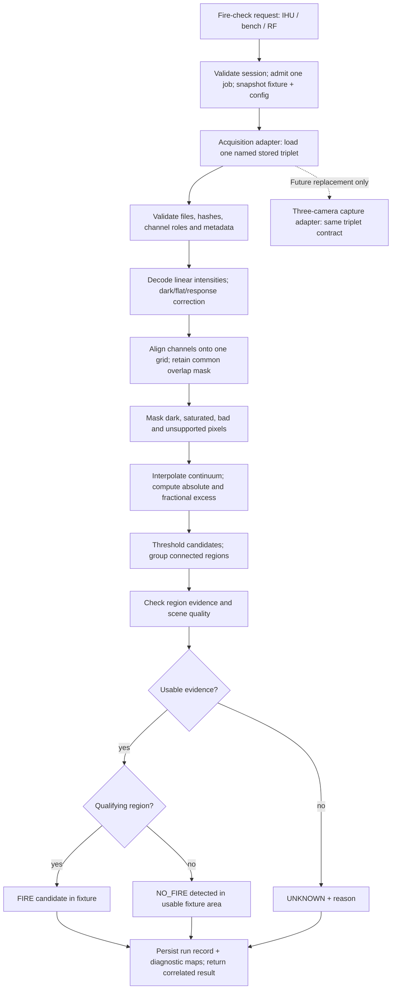

# Payload user guide

[Operator guides](README.md) · [IHU console](ihu-can-console.md) · [Yamcs](yamcs.md)

This guide covers the Raspberry Pi 4 on the LibreCube LC2502, payload software
**0.2.0**, IHU **0.13.0**, and the five implemented payload operations. Checked
against repository source and the installed Pi identity on October 17, 2026.
Earlier IHU 0.12.0 fire-check transcripts below remain useful examples of the
same payload protocol. Boot IDs, request IDs, uptimes and counters vary per run.

The payload responds on **CAN A at 500 kbit/s**, node **4**. It starts its CAN
interface and responder at boot without needing Wi-Fi or an open console.
It does not send periodic heartbeats or fire results on its own.

Fire check currently returns **NO_FIRE / STATIC_STUB**. It increments a check
counter but does not invoke a camera or detection algorithm. There are no
implemented camera, image acquisition/download, detector configuration,
payload power-switch, or CAN reboot/shutdown commands. Linux maintenance is
available separately through SSH.

## Stored-image detector and planned command integration

The offline image pipeline is implemented in
[`firmware/payload/ember_detector`](../../firmware/payload/ember_detector/README.md),
with replaceable basic and registration-guarded spectral detectors, validated
configuration, per-run evidence and batch threshold evaluation. It runs real
image processing on selected stored files. The running 0.2.0 CAN responder still
returns the static stub described above; camera acquisition and commanded-image
integration remain subsequent stages. Its image acquisition adapter uses fixtures;
the offline detection stage is not a stub.

The baseline is the spectral approach in
[`koenig_wildfire`](https://github.com/ngrabbs/koenig_wildfire), reviewed at
commit `d98e8b5f4ba283d4879dfe04be505441480e8abb`. EMBER will implement its own
small processing modules and configuration contract rather than importing the
camera daemon or web application. That reference contains documents from
different stages of development: the August pipeline review predates the
September burn evidence. Neither its historical thresholds nor its reported
burn measurements establish thresholds or accuracy for this implementation.

### End-to-end target flow



Every stage may fail to UNKNOWN. Missing inputs, invalid calibration, bad
registration, timeout or insufficient usable area must never become NO_FIRE.
NO_FIRE means no qualifying signature was detected within the usable data and
configured sensitivity; it does not prove that no fire exists in the scene.
A positive fixture result demonstrates the processing decision, not a current
observation of the spacecraft's surroundings.

### 1. Select a fixture instead of capturing cameras

A fixture is a named triplet of the **same scene**, with separate low-reference,
on-line and high-reference images. Start with the reference arrangement
750/770/780 nm, but store actual channel wavelengths in metadata. The reference
also supports 760/770/780 nm; that arrangement uses different interpolation
weights. Do not infer channel assignment solely from camera port or filename.

Each fixture manifest must record:

| Field | Purpose |
|---|---|
| `fixture_id`, `scene_id`, `source_kind` | Stable case, grouping for evaluation, and `RECORDED` or `SYNTHETIC` provenance |
| Per-channel role, wavelength and file SHA-256 | Prove which image was analyzed and prevent silent role swaps |
| Pixel encoding, bit depth, black/white levels, linearity | Decode intensities without guessing from the file's maximum value |
| Exposure time and gain per channel | Establish comparable response; arbitrary gain numbers are not necessarily linear multipliers |
| Calibration ID/hash and processing stage | Distinguish sensor-native, corrected, and already registered inputs; prevent applying corrections twice |
| Registration transforms/quality, if precomputed | Establish common pixel coordinates and usable overlap |
| Original timestamps/channel timing, when known | Preserve sequential-capture differences even though fixture replay itself is instantaneous |
| Evaluation label and its source | FIRE / NO_FIRE / UNKNOWN ground truth, used only by the evaluation runner |

The acquisition adapter returns arrays plus this metadata, with
`input_source=STORED_FIXTURE` and `camera_capture_performed=false`. Keep the
original image time separate from analysis time. Re-running one fixture must
not fabricate new camera acquisition times or count as independent evidence.
Use an explicitly selected active fixture; do not silently alternate fire and
no-fire cases across CAN requests. Batch evaluation selects cases explicitly.

Ordinary RGB fire photographs are not interchangeable with these spectral
triplets. Three copies of one image do not provide independent spectral
measurements. Synthetic triplets with known injected signals are useful for
software correctness tests, but do not establish real-world detection accuracy.
The supplied `payload_images_20261014.zip` has now been inventoried: 411
JPEGs form 137 complete triplets, with filename roles cam0=770 nm, cam1=750 nm,
cam2=780 nm. All images decode at 1456 × 1088 in an RGB JPEG container; this
alone does not establish sensor linearity or independent colour measurements.
The 13 bracket CSVs cover 405 images (135 complete triplets), list exposure,
and record gain as `-` (unknown). Two triplets, `20261014_174904_481` and
`20261014_174917_554`, have no bracket rows. No fire/no-fire labels or identified
calibration manifest are supplied. The initial inventory left all truth labels UNKNOWN pending review.
The visual-review selection below now defines the initial development labels. Preserve the original archive and input hashes;
do not infer labels, calibration status or filter installation from filenames.
The archive SHA-256 is
`4a4bedae9231e50a5c62acd84be13fcc7781eb9f80e97c02e2c503cb7fb2d73a`.

### Selected development fixtures

After visual review of all 137 triplets, the operator chose to exclude every
uncertain case. The initial dataset contains **107 triplets (321 images):
76 FIRE and 31 NO_FIRE**. The 30 uncertain triplets are excluded from the working
set, including 21 nearly black captures, one weak early capture and eight
smoke/fading cases. Original source files remain unchanged.

The versioned [fixture manifest](../../firmware/payload/fixtures/payload_images_20261014/manifest.json)
records every selected file/hash, its label, metadata and the excluded capture
IDs. These are user-accepted visual labels, not independent laboratory ground
truth; NO_FIRE here means no visible flame identified. The selection intentionally
omits difficult cases, so accuracy measured only on this subset will not describe
performance on dark, weak or ambiguous scenes. All cases remain development data
until an independent evaluation split is established.

Capture `20261014_174904_481` remains selected as FIRE but lacks bracket metadata.
Its exposure and gain stay unknown; classification confidence does not establish
calibration compatibility. Other retained cases have bracket exposure metadata
but gain is also unknown. The manifest keeps image-quality/metadata limitations
separate from the visual class. Raw JPEGs are packaged locally with the manifest
for copying to the Pi, not added to Git. This selection does not enable the new
detector or change the running CAN responder.

### Available calibration product

The reference repository includes
[`calibration/correction_20261003.npz`](https://github.com/ngrabbs/koenig_wildfire/blob/d98e8b5f4ba283d4879dfe04be505441480e8abb/calibration/correction_20261003.npz),
with gain and dark maps for camera ports 0, 1 and 2. All six maps have shape
1088 × 1456, matching the supplied October 14 JPEG dimensions. Its SHA-256 is
`0649ecedd1d68e31f2cc58bd4808946c8a360d157b22db5debfe2b227df58b51`.
This is a candidate calibration asset, not evidence that every October 14
capture used the same optics or processing state.

The associated
[calibration notes](https://github.com/ngrabbs/koenig_wildfire/blob/d98e8b5f4ba283d4879dfe04be505441480e8abb/calibration/README.md)
describe PTFE-panel flats and lens-cap darks at 24000 microseconds, gain 1.0.
They supersede older project pages that say no valid flat exists. The notes
exclude roughly the outer 10% of the field from trusted calibration and void
the correction if focus/filter placement changes. Retain a documented usable
ROI; do not assume the NPZ contains a per-pixel validity mask (it does not).
The original raw calibration frames are documented as living on the original
payload under `~/payload_images/20261003_*`; they are not committed in the
reference repository.

October 14 bracket metadata spans 50–800 microseconds and does not establish
gain. Do not blindly subtract the 24000-microsecond dark maps from those
frames. Establish the optical configuration, existing image corrections and
exposure-appropriate dark treatment before calling this a quantitatively
calibrated test. In particular, near-zero dark values reported by the source
are not a substitute for a documented compatibility decision.

### 2. Prepare comparable, aligned signals

Decode into floating-point linear intensity using declared encoding. A JPEG
or display PNG may have unknown gamma, clipping or automatic image processing;
accept it for exploratory analysis only with an explicit preprocessing profile
and an uncalibrated provenance flag. File format alone does not establish
linearity. Use calibrated linear monochrome data for quantitative validation.

For sensor-native images, subtract the applicable dark/black signal, apply
flat-field maps in **sensor coordinates**, then normalize exposure and calibrated
channel response. A simple linear response model is:

```text
S_channel = (raw - dark) * flat_gain * response_scale / exposure_time
```

The profile must define the units and which exposure/gain effects are already
included in calibration. Do not divide twice by exposure or assume a sensor's
reported gain value equals sensitivity. Never normalize every channel to its
own mean, histogram or maximum: that can remove the spectral excess we seek.

Then register the reference channels onto the selected common grid and carry
validity masks through the transform. Keep only common overlap; padded borders
must not become valid zero-valued measurements. Use validated fixed transforms
for the first controlled fixtures. Add automatic registration later if needed,
with an explicit quality gate. A failed fit is not a reason to assume identity
alignment. Calibration must precede resampling; manifest-declared corrected or
registered inputs skip only the stages already completed and verified.

### 3. Measure spectral excess

For wavelengths `lambda_low < lambda_on < lambda_high`, define:

```text
w = (lambda_on - lambda_low) / (lambda_high - lambda_low)
C = (1 - w) * S_low + w * S_high
E = S_on - C
K = E / C                  # only where the continuum passes its signal floor
```

For 750/770/780 nm, `C = S750/3 + 2*S780/3`. For 760/770/780 nm,
`C = (S760 + S780)/2`. `K=0.25` means the on-line signal is 25% above the
interpolated continuum; it is not a 25% probability of fire. Positive excess
alone is not sufficient for a fire decision. Instrument imbalance, scene
spectral structure, misregistration and sequential capture changes can also
produce it. The continuum model is a baseline to test, not a universal
background model.

For a numerical example, let corrected `S750=100`, `S780=130` and
`S770=160` in the same signal units. Then `C=120`, `E=40` and `K=1/3`.
An illustrative K threshold of 0.25 would admit that pixel, while 0.40 would
reject it. It still needs the absolute-excess, validity and region checks.
This arithmetic example does not select a validated operational threshold.

Build a validity mask from all channels: finite values, sufficient continuum,
no raw saturation, usable calibration pixels and common registration overlap.
Preserve raw saturation flags through correction/resampling. Do not convert
invalid pixels to valid K=0 or manufacture a large ratio by dividing by epsilon.

### 4. Turn pixel evidence into a scene decision

A valid pixel is a candidate only when both `K >= k_threshold` and
`E >= excess_min`. The absolute-excess gate guards against large fractional
ratios at low signal. An optional signal-to-noise gate may be added only after
an uncertainty model exists; K is not itself SNR or confidence.

Group candidates with a defined pixel connectivity. Require a minimum region
area, and record each region's area, bounding box, peak/median K, excess and
usable support. Optional morphology must have a defined order, kernel and
iterations: it can erase small genuine sources or join unrelated artifacts.
Disable it in the first transparent baseline. Freeze analysis resolution so
pixel-area thresholds have a stable meaning. Border/saturation-invalidated
regions and poor registration contribute explicit quality reasons.

A qualifying supported region produces FIRE. No qualifying region produces
NO_FIRE only when the scene passes coverage and quality gates. A frame whose
possible source is clipped or outside usable coverage may be UNKNOWN rather
than a negative. Record masked/candidate fractions and reason codes alongside
both decisions. Temporal persistence is deferred until independent capture
sequences exist; repeated replay of one stored image cannot provide it.

### Tunable configuration

Store a versioned, validated configuration file on the Pi. Each job snapshots
an immutable configuration and records its hash; edits affect subsequent jobs.
Start by tuning locally over SSH and batch evaluation. New CAN commands for
remote tuning are outside this first interface; arbitrary file paths or
threshold mutations must not be smuggled into the current empty FIRE_CHECK
request. The table below describes the target configuration. Exact implemented offline
keys and run commands are in the [detector README](../../firmware/payload/ember_detector/README.md)
and `firmware/payload/config/*.json`; remote tuning is not a current CAN operation.

| Proposed setting | Units / valid domain | What it controls |
|---|---|---|
| `input.fixture_id` | Manifest ID | Exact stored case analyzed by a commanded check |
| `channels.*.wavelength_nm` | Positive, low < on < high | Continuum weights; measured filter metadata, not a classifier tuning shortcut |
| `preprocess.profile_id`, `calibration.id` | Versioned IDs | Encoding, dark/flat/response and exposure treatment |
| `registration.mode` | `prealigned` / `fixed_transform` initially | How common scene coordinates are established |
| `registration.max_error_px` | Nonnegative pixels, defined metric | Maximum acceptable measured alignment residual |
| `analysis.roi`, `analysis.resolution` | Bounds and width/height in pixels | Fixed analyzed area and scale |
| `quality.continuum_min` | Positive, calibrated signal units | Minimum denominator for a usable K measurement |
| `quality.saturation_margin` | Declared raw-code or full-scale units | Reject near-clipped sensor values before correction |
| `quality.min_valid_fraction` | 0–1 of the declared ROI | Minimum usable coverage for a scene decision |
| `quality.max_saturated_fraction` | 0–1, plus candidate-region checks | When clipping prevents a defensible decision |
| `detection.k_threshold` | Nonnegative, dimensionless | Minimum fractional on-line excess |
| `detection.excess_min` | Nonnegative, same units as E | Minimum absolute on-line excess |
| `regions.min_area_px` | Positive integer | Minimum connected candidate area at the fixed analysis resolution |
| `regions.connectivity` | 4 or 8 | Whether diagonal neighbors join |
| `regions.morphology` | Disabled initially; later bounded kernels/iterations | Optional candidate cleanup, reported explicitly |
| `runtime.max_analysis_ms` | Positive, within end-to-end deadline | Bound a job instead of hanging CAN service |
| `runtime.max_pixels`, `runtime.max_input_bytes` | Positive bounds | Bound decoded image memory and file loading |
| `diagnostics.save_maps`, `diagnostics.retention` | Boolean and bounded disk quota/count | Reproducibility without filling the SD card |

Do not publish empirical detection defaults before reviewing the fixture
collection. Use an explicitly labeled synthetic test profile for unit tests;
its thresholds are not deployment recommendations. Calibration constants and
channel assignments belong to the instrument profile. Detection thresholds
belong to the experiment profile. Keep these separate so tuning cannot hide
instrument errors. If a noise/SNR gate is later introduced, its calibrated
uncertainties and threshold become additional versioned inputs.

### Replaceable detector interface

A detector implements `algorithm_id`, `validate(settings)` and
`detect(Scene, settings) -> Result`. The Scene contains corrected, aligned
channels and validity information; the Result contains FIRE/NO_FIRE/UNKNOWN,
reasons and evidence. A detector does not load fixture files, see evaluation
labels, control cameras or handle CAN. Add a new factory to the explicit
registry and select its ID in configuration; acquisition and reporting remain
independent of the algorithm. The supplied `spectral_excess_v1` and
`spectral_guarded_v1` implementations exercise that separation. Algorithm-specific
settings live under `detector`; its implementation validates their schema.

### Outputs, CAN integration and timing

Each analysis should save a compact structured record containing a unique run
ID, requester/check correlation, fixture/input hashes, config/calibration hashes,
algorithm version, source/analysis times, per-stage timings, result and reasons,
quality metrics and candidate-region measurements. Save optional K/validity/
candidate maps and overlays locally; they need not cross CAN. Ground-truth
labels must never enter the detection decision. A local batch runner adds
comparison with labels after inference.

The current v1 FIRE_RESULT has only result 0/1, mode 1/2, boot, uptime and check
ID. It cannot express fixture provenance, quality failure reasons or a fixture/
configuration identity. `ALGORITHM` would describe the computation but would
not tell ground that the images were prerecorded. Before CAN deployment,
version the result contract and update the Pi, shared IHU validators, bench/RF
wrappers, dictionary and Yamcs display together. Preserve legacy decoding of
historical results. Do not repurpose the required-zero reserved byte or silently
report fixture decisions as current camera observations. Keep processing
failure distinct from NO_FIRE, with explicit failure telemetry/command outcome.

A bounded worker should perform image work while the CAN loop continues to
handle discovery and diagnostics. Admit at most one analysis job initially;
reject additional work as busy without starting another check. Measure Pi 4
runtime, including loading, decode, calibration, registration and reply transfer.
Today the bench/client exchange deadline is three seconds and the IHU application
deadline is five seconds; the RF path adds its own finite window. These are
integration limits, not demonstrated image-processing budgets. Either prove
that the complete transaction fits or add coordinated long-job admission/result
handling and deadlines. Do not simply block the current handler or precompute a
fixed answer and call it a fresh algorithm run.

### Evaluation and staged delivery

1. **Analytical tests:** matched continuum gives K=0; known injected on-line
   excess gives the expected K and region; swapped channels, invalid metadata,
   zero continuum, clipping, corrupt files and misalignment exercise UNKNOWN.
2. **Stored-image baseline:** run the same detector locally on the Pi over a
   labeled corpus; retain deterministic outputs and stage timings. Include
   flames, embers/hot continuum, lamps/reflections, vegetation, low signal,
   saturation and alignment artifacts where real data is available. Ambiguous
   labels remain UNKNOWN; different fuels/scenes need separate evidence.
3. **Tune and hold out:** sweep K/excess/area thresholds over a development
   subset; report per-scene false positives, misses, precision/recall and
   UNKNOWN coverage on a separate held-out subset. Keep triplets from the same
   burn/scene/session together to avoid leakage. Exclude UNKNOWN from binary
   scores only with its count/rate reported separately. Use the same held-out
   set and metric definitions when comparing profiles.
4. **Command integration:** deploy fixture-tagged results and the coordinated
   protocol/display changes, then verify IHU and Yamcs correlation, timeout,
   restart and busy behavior. Do not transmit RF merely to tune a threshold.
5. **Camera integration later:** replace the fixture adapter with three-camera
   acquisition and preserve the analysis contract. Requalify timing, exposure,
   calibration and alignment; fixture success does not validate live capture.

Reference sources for the baseline are the pinned
[K-index implementation](https://github.com/ngrabbs/koenig_wildfire/blob/d98e8b5f4ba283d4879dfe04be505441480e8abb/tools/k_index.py),
[flat-field tool](https://github.com/ngrabbs/koenig_wildfire/blob/d98e8b5f4ba283d4879dfe04be505441480e8abb/tools/flat_field.py),
[registration tool](https://github.com/ngrabbs/koenig_wildfire/blob/d98e8b5f4ba283d4879dfe04be505441480e8abb/tools/register_triplets.py)
and [September detection evidence and limits](https://github.com/ngrabbs/koenig_wildfire/blob/d98e8b5f4ba283d4879dfe04be505441480e8abb/docs/potassium_detection.md).

## Choose an interface

| Interface | Where to use it | What it provides |
|---|---|---|
| SSH | `ngrabbs@192.168.1.253` (`ember-pi`) | Service control, logs, identity, CAN statistics, Linux reboot/shutdown |
| Direct SocketCAN client | A Linux host on the same CAN A bus, including the Pi itself | All five operations; automatically establishes HELLO |
| IHU USB console | IHU connected to m75q, `192.168.1.252` | Discovery, target selection and all five operations |
| Yamcs `ember-bench` / `realtime` | Ground station `http://192.168.1.251:8090` | All five operations over LAN → IHU USB → CAN A |
| Yamcs `ember` / `realtime` | Same ground station | Fire check over a bounded real RF transaction → IHU → CAN A |

The historical `ember-payload` instance is not the current operational bench
instance. Use `ember-bench`. The retired `ember-payload-bridge` service stays
disabled; `ember-bench-bridge` is the shared IHU serial owner.

## On the Pi: readiness, logs and maintenance

Connect:

```sh
ssh ngrabbs@192.168.1.253
```

### Check readiness and installed version

```sh
systemctl status ember-payload-can ember-payload --no-pager
ip -details -statistics link show can0
cat /opt/ember-payload/build_identity.json
sudo journalctl -b -u ember-payload-can -u ember-payload --no-pager
```

`ember-payload-can` is a successful oneshot: **active (exited)** is normal.
`ember-payload` should be **active (running)**. The link should be UP, bitrate
500000, and normally `ERROR-ACTIVE` (the healthy CAN error-confinement state).
Inspect RX/TX error counts as well as packet counts.

The installed identity was:

```json
{"git":"c35262eda021e9819d4263616769c77ce3736e75","dirty":0,"version":"0.2.0"}
```

A startup line looks like this recorded example:

```text
CAN_READY interface=can0 node=4 boot=4034088014 git=c35262eda021e9819d4263616769c77ce3736e75 version=0.2.0
```

`boot` identifies this responder process, not the Linux kernel boot. Restarting
the service changes it and clears its session and counters. The file identity
reports the installed software; a CAN IDENT reply verifies what the live
responder reports.

### Tail incoming commands

```sh
sudo journalctl -u ember-payload -f -o cat
# Fire-check requests only:
sudo journalctl -u ember-payload -f -o cat | grep --line-buffered 'type=98'
# Only messages from this Linux boot:
sudo journalctl -b -u ember-payload -o cat
```

Recorded request examples:

```text
REQUEST type=01 origin=1765436985 request=64 reply=02
REQUEST type=98 origin=1765436985 request=65 reply=99
```

Types in these log lines are **hexadecimal**. `origin` is the requester session
ID; `request` correlates that request and reply. `reply=99` means the handler
produced a fire-result response to queue; it does not prove that the IHU or
ground station received it. Look for the correlated IHU RESULT or Yamcs command
completion to establish end-to-end success. Rejections show `reply=7f`.
Discovery frames and malformed/incomplete application frames do not each get
an application `REQUEST` line. `BUSY reply queue full` indicates dropped work.

### Start, stop or restart

Run these on the Pi:

```sh
sudo systemctl stop ember-payload
sudo systemctl start ember-payload
sudo systemctl restart ember-payload
```

Stopping the responder also stops payload discovery replies. It does not take
the CAN interface down. If CAN initialization failed, fix the cause, then run:

```sh
sudo systemctl restart ember-payload-can
sudo systemctl start ember-payload
```

When deliberately reconfiguring an already running CAN interface, stop
`ember-payload` first, restart `ember-payload-can`, then start the responder.
Enable both for boot, or disable both to prevent automatic startup:

```sh
sudo systemctl enable ember-payload-can ember-payload
# Disable boot startup and stop the responder:
sudo systemctl disable ember-payload-can ember-payload
sudo systemctl stop ember-payload
```

Linux reboot and shutdown are SSH operations, not CAN services:

```sh
sudo reboot
sudo shutdown -h now
```

After reboot, check readiness again and establish a fresh CAN HELLO before
querying. The startup helper probes the MCP2515 at most 20 times; it does not
retry indefinitely. The service does not automatically recover CAN bus-off.

### Observe raw traffic

With `can-utils` installed:

```sh
candump can0,700:7FF,704:7FF,740:7FF,741:7FF
```

This displays discovery and fragmented application traffic. It does not decode
application results. It can run alongside the responder without replacing the
HELLO session. Raw CAN frames are not the same as completed application requests.

## From the IHU USB console

On m75q, identify and release the current serial owner before opening a terminal:

```sh
ssh ngrabbs@192.168.1.252
systemctl is-active ember-bench-bridge
sudo systemctl stop ember-bench-bridge
python3 -m serial.tools.miniterm \
  /dev/serial/by-id/usb-Raspberry_Pi_Pico_DF641455DB822427-if00 115200
```

This requires pyserial. Exit miniterm with **Ctrl+]**. After closing the terminal,
restore the bridge if it was initially active:

```sh
sudo systemctl start ember-bench-bridge
```

Do not open another program on the same port. Stopping the bridge suspends
Yamcs bench commands and serial forwarding. The separate `ember-fire-arm`
service uses the COMMS port, not this IHU port.

The IHU takes case-sensitive lines terminated by CR or LF. It has no prompt;
boot is quiet. Solicited replies work with every output stream OFF. In IHU
0.13.0 these manual application requests require the GROUND_TEST configuration;
FLIGHT rejects this console path with `FLIGHT_ROUTINE_STUB`. See the
[IHU mode/output policy](../architecture/operations/04-ihu-runtime-policy.md).

| Console command | Purpose / expected result |
|---|---|
| `help` | List actual commands in this IHU image |
| `version` | Verify `role=IHU_MCU` and firmware identity |
| `status` | IHU CAN readiness, selected target, peer ID, counters and pending work; not a payload status query |
| `devices` | Registry presence, age, boot identity and timeout counts |
| `devices scan` | Schedule background discovery; does not establish HELLO |
| `hello payload` | Select payload route and establish session; `CAN_HELLO_CONFIRMED` |
| `ping N` | Echo 1–240 bytes on the selected target; `CAN_ECHO_MATCHED` |
| `payload ident` | 32-byte identity; `FIRMWARE_IDENTITY` |
| `payload status` | 28-byte status snapshot; `PAYLOAD_STATUS` |
| `payload heartbeat` | Fresh 28-byte snapshot; `PAYLOAD_HEARTBEAT`; does not enable a timer |
| `payload fire-check` | One 16-byte fire result; `PAYLOAD_FIRE_RESULT` |
| `hello comms` / `hello lte` | Leave the payload route and establish the selected subsystem session |
| `normal` | Restore IHU CAN normal mode and clear remembered peer; HELLO required afterward |

Run this sequence **one line at a time**, waiting for each terminal RESULT:

```text
version
status
devices
hello payload
ping 8
payload ident
payload status
payload heartbeat
payload fire-check
hello comms
```

`ping N` sends bytes `00 01 ... N-1`. Other payload requests take no arguments.
Always select `hello payload` first: `ping` otherwise acts on the previously
selected subsystem. Discovery `ONLINE` alone does not authorize application
queries. The `selftest` command is an IHU local loopback diagnostic and leaves
loopback enabled; use `normal` and HELLO afterward if you used it.

### Example IHU replies

A recorded hardware fire-check transaction (IHU 0.12.0, payload 0.2.0):

```text
SUBMITTED request=1 type=1 bytes=0
RESULT request=1 outcome=CAN_HELLO_CONFIRMED peer=1559660849 bytes=0 hex=
SUBMITTED request=2 type=152 bytes=0
RESULT request=2 outcome=PAYLOAD_FIRE_RESULT peer=1559660849 bytes=16 hex=010001005cf689310001d62c00000001
FIRE_CHECK result=no_fire mode=STATIC_STUB check_id=1
```

Here console `type=152` is decimal (`0x98`). The 16 data bytes decode to version
1, NO_FIRE, STATIC_STUB, reserved 0, boot 1559660849, uptime 120364 ms, check ID 1.
The `FIRE_CHECK` summary can follow the RESULT asynchronously.

Recorded identification reply:

```text
FIRMWARE_REPLY peer=1559660849 version=0.2.0 dirty=0
RESULT request=8 outcome=FIRMWARE_IDENTITY peer=1559660849 bytes=32 hex=00020000c35262eda021e9819d4263616769c77ce3736e755cf689310001d6f5
```

Illustrative ping and status replies, with synthetic IDs/counters:

```text
SUBMITTED request=2 type=112 bytes=8
RESULT request=2 outcome=CAN_ECHO_MATCHED peer=42 bytes=8 hex=0001020304050607
PAYLOAD_REPORT boot=42 uptime_ms=1000 requests=3 replies=2 rejected=0 fragment_errors=0
RESULT request=3 outcome=PAYLOAD_STATUS peer=42 bytes=28 hex=010401000000002a000003e800000003000000020000000000000000
```

A heartbeat uses the same report layout and `outcome=PAYLOAD_HEARTBEAT`.
`ready=1` means the responder is running, not that cameras or a detector are ready.

## Direct Linux CAN client

From the repository root on a Linux host with an already configured `can0`:

```sh
python3 firmware/payload/client.py --interface can0 ping
python3 firmware/payload/client.py --interface can0 ident
python3 firmware/payload/client.py --interface can0 status
python3 firmware/payload/client.py --interface can0 heartbeat
python3 firmware/payload/client.py --interface can0 fire-check
```

Each invocation sends HELLO, then one operation. The client ping echoes the
fixed five-byte ASCII string `EMBER`; it has no size argument. It waits up to
three seconds per exchange and does not retry the operation automatically.
Example output using the recorded fire-result data:

```text
fire-check: boot=1559660849 request=2 payload=010001005cf689310001d62c00000001
```

The client requires `client.py` and `protocol.py` from the source/export. The
normal installed `/opt/ember-payload` runtime does not include `client.py`.
Do not run a second responder to test the existing one. A client on the same
Pi can communicate with the running responder using SocketCAN local delivery.

A client HELLO **replaces the IHU session**. Coordinate ownership and run
`hello payload` again on the IHU afterward. Two independent command sources
can invalidate each other's sessions. The payload has no command deduplication
cache: a repeated accepted fire-check request can increment `check_id` again.

## Through Yamcs

Use the current [bench payload display](http://192.168.1.251:8090/telemetry/displays/files/Payload.opi?c=ember-bench__realtime)
or [flight payload display](http://192.168.1.251:8090/telemetry/displays/files/Payload.opi?c=ember__realtime).
Firmware identity is on **Devices & firmware**. Inspect the selected instance,
reply timestamps, payload boot and command history before treating a value as
current. Old values can remain visible after a disconnect.

| Yamcs command | Arguments | IHU operation | Bench | Flight RF |
|---|---|---|---|---|
| `PAYLOAD_PING` | `bytes`: 1–240 | `ping N` | Yes | No |
| `PAYLOAD_IDENT` | None | `payload ident` | Yes | No |
| `PAYLOAD_STATUS_QUERY` | None | `payload status` | Yes | No |
| `PAYLOAD_HEARTBEAT_QUERY` | None | `payload heartbeat` | Yes | No |
| `PAYLOAD_FIRE_CHECK` | None | `payload fire-check` / native RF dispatch | Yes | Yes |

Use **Commanding → Send a command**, select `/ember/PAYLOAD_…`, configure any
arguments and send once. In bench, the bridge verifies IHU CAN readiness and
establishes `hello payload` automatically. It reports admission after the IHU
submits the request and completion after a validated matching reply. A
pre-dispatch refusal is a rejection; an ambiguous post-dispatch timeout stays
UNKNOWN. Inspect that command's correlated history rather than only the last
shared result parameter. There is no automatic application retry.

Payload telemetry groups are `PAYLOAD_STATUS`, `PAYLOAD_FIRMWARE`,
`PAYLOAD_PING_RESULT` and `PAYLOAD_FIRE_RESULT`. Fire results include `result`,
`execution_mode`, `reported_boot_id`, `reported_uptime_ms` and `check_id`.
Transport provenance is `IHU_CONSOLE_CAN_BENCH` (1) or `IHU_NATIVE_RF` (2).
NO_FIRE is valid only with an actual validated result; timeout is never NO_FIRE.

The flight command path uses LibreSDR → COMMS → IHU → payload and returns one
correlated native result over RF. USB arms a finite COMMS receive/reply window;
it does not carry the flight command/result. This transmits RF and requires
exclusive radio ownership and the configured arming/uplink services. Follow
[the fire-check runbook](../../ground/yamcs/FIRE_CHECK.md) before using it.
It is not an always-listening flight receiver. Do not run a live radio receiver
and the fire-check radio owner concurrently. Console stream switches do not
need to be enabled for a solicited fire-check reply.

For bridge-side diagnostics on m75q:

```sh
systemctl status ember-bench-bridge --no-pager
journalctl -u ember-bench-bridge -f -o cat
```

## Complete CAN command contract

These identifiers are **standard 11-bit classic CAN**, with at most eight data
bytes per frame. They are development addressing/correlation, not authentication.

| Purpose | CAN identifier | Data |
|---|---|---|
| Discovery query | `0x700` | Single eight-byte discovery request addressed to node 4 |
| Discovery reply | `0x704` | Single eight-byte discovery response |
| Application requests | `0x740` | Fragmented encoded packet |
| Application replies | `0x741` | Fragmented encoded packet |

Discovery is `version:u8=1, node:u8=4, nonce:u16, sender_boot:u32`, big endian;
nonce and sender must be nonzero. The reply echoes version/node/nonce and
substitutes the payload boot. Example: query `0104123400000001`, reply
`010412340000002a` for nonce `0x1234`, requester boot 1, payload boot 42.
Discovery does not establish a session. COMMS `0x710/0x711`, LTE `0x720/0x721`
and RF uplink `0x730/0x731` are separate routes.

### Accepted application types

The following are **packet types**, not CAN IDs or standalone one-byte frames.

| Request | Reply | Name | Request data | Reply data |
|---|---|---|---|---|
| `0x01` | `0x02` | HELLO | Empty | Empty; establish/replace requester session |
| `0x70` | `0x71` | ECHO / ping | 1–240 arbitrary bytes | Identical bytes |
| `0x18` | `0x19` | IDENT | Empty | 32-byte identity |
| `0x94` | `0x95` | STATUS | Empty | 28-byte report |
| `0x96` | `0x97` | HEARTBEAT | Empty | Fresh 28-byte report |
| `0x98` | `0x99` | FIRE_CHECK | Empty | 16-byte fire result |
| — | `0x7F` | ERROR | — | One-byte rejection reason |

All decoded requests require protocol version 1 and equal, nonzero `sender`
and `origin` IDs. HELLO sets the accepted requester ID; subsequent operations
must use that ID. Replies carry the payload's sender boot and preserve request
origin/request ID. After payload restart or another client's HELLO, establish
HELLO again. Session IDs provide correlation, not access control.

Rejection reasons are `1` unsupported version, `2` unsupported type, `3` invalid
or missing requester session, `4` invalid command data. Corrupt CRC, invalid
framing, wrong route and incomplete/oversize packets are discarded without an
application ERROR. Absence of a reply is UNKNOWN.

### Packet and fragment encoding

All multibyte application fields are big endian. Before encoding:

```text
magic[2]="EU" | version:u8 | type:u8 | sender:u32 | origin:u32 |
request:u32 | payload_length:u16 | payload[0..240] | crc:u16
```

CRC is CRC-16/CCITT-FALSE (initial `0xFFFF`) over header and payload. COBS-encode
header, payload and CRC together, then append a zero delimiter. Maximum encoded
length is 263 bytes. Split that into chunks of up to four bytes. Each CAN data
field is:

```text
flags:u8 | token:u16 | fragment_index:u8 | encoded_chunk[1..4]
```

Flags start at `0x10`, with bit 0 for START and bit 1 for END. Token is the low
16 bits of request ID; index begins at zero and increments. Nonfinal fragments
carry four encoded bytes. The receiver has a 500 ms interfragment timeout and
rejects duplicate starts and out-of-order fragments. Use
[`protocol.py`](../../firmware/payload/protocol.py) or the C transport codec;
`cansend can0 740#98` is not a valid fire-check request.

### Decoding reply data

Offsets below are relative to the **decoded application payload**, not the CAN
frame, COBS packet or Yamcs wrapper.

| Reply | Byte offsets and meaning |
|---|---|
| IDENT, 32 bytes | 0–2: version major/minor/patch; 3: dirty (0/1); 4–23: source SHA bytes; 24–27: daemon boot; 28–31: daemon uptime ms |
| STATUS / HEARTBEAT, 28 bytes | 0: report version 1; 1: node 4; 2: ready 1; 3: reserved 0; 4–7: boot; 8–11: uptime ms; 12–15: requests; 16–19: replies; 20–23: rejected; 24–27: fragment errors plus timeouts |
| FIRE_RESULT, 16 bytes | 0: report version 1; 1: result (0 NO_FIRE, 1 FIRE); 2: execution mode (1 STATIC_STUB, 2 ALGORITHM); 3: reserved 0; 4–7: boot; 8–11: uptime ms; 12–15: check ID |

Status counts include the current request, but the replies count is taken
before incrementing for that status/heartbeat reply. These are handler/queued
reply counters, not proof of bus delivery; SocketCAN statistics are separate.
Uptime and report counters are 32-bit; fire check IDs run from 1 through
`0xFFFFFFFF`, then wrap to 1. All reset when the responder restarts. The current
stub always reports result 0/mode 1; mode 2 is a defined future algorithm value.

## Troubleshooting

| Symptom | Check / action |
|---|---|
| SSH works, no CAN replies | Check both services, existence of `can0`, bitrate and `ip -s -d link show can0` |
| `can0` absent; `MCP251x didn't enter in conf mode after reset` / error -110 | SPI/controller initialization failed before application CAN traffic. Inspect controller power/reset/connections and boot logs. A software reboot recovered the observed October 17 cold-power failure; its underlying cause remains unresolved |
| Payload service inactive with dependency failure | CAN setup failed; after recovery restart CAN setup and explicitly start the responder |
| CAN up but no application reply | Verify 500 kbit/s, normal mode, correct route, termination and fresh HELLO; inspect controller and fragment error counters |
| `REJECT reason=BUSY_TARGET_SWITCH` | IHU discovery/transaction holds the route; wait for it to finish before selecting again |
| `REJECT reason=HELLO_REQUIRED` or payload ERROR reason 3 | Re-establish `hello payload`; another client's HELLO or a restart may have changed session |
| `PAYLOAD_TARGET_REQUIRED`, `WRONG_TARGET` or `PAYLOAD_READ_ONLY_SERVICES` | Select payload before payload queries; power/LTE/UHF operations do not belong on its route |
| `REJECT reason=UHF_RUN_ACTIVE` | Let the bounded IHU UHF run finish, or explicitly stop it with `uhf stop` before switching target |
| `REJECT reason=NORMAL_MODE_REQUIRED` | Restore IHU `normal`, then obtain HELLO again |
| Old Yamcs values, no new requests in Pi log | Verify `ember-bench`, bridge ownership/readiness and timestamps; the old `ember-payload` URL/service is historical |
| Fire result absent/corrupt/timeout | Treat as UNKNOWN, never NO_FIRE; inspect the correlated command history and route logs |

## Updating or manually running the responder

Normal operation uses systemd. To replace the installed runtime, use a clean
source checkout and export into a **new** destination from the repository root:

```sh
python3 firmware/payload/export.py /tmp/ember-payload-export
scp -r /tmp/ember-payload-export ngrabbs@192.168.1.253:~/payload-export
ssh ngrabbs@192.168.1.253 'sudo sh ~/payload-export/install.sh'
```

Use a new remote export directory as well if `~/payload-export` already exists.
The installer replaces the runtime/service files, enables both units, configures
CAN and starts the responder. It does not rewrite Wi-Fi or boot overlays. The
export records source Git SHA, dirty flag and VERSION in `build_identity.json`.
See [installation details](../../firmware/payload/README.md#installation-and-startup)
for the required CAN A SPI0/16 MHz/GPIO25 boot overlay; CAN B remains unused.

For foreground diagnosis, stop the service first, ensure `can0` is configured,
then run one responder in a terminal on the Pi:

```sh
sudo systemctl stop ember-payload
python3 /opt/ember-payload/payload.py \
  --interface can0 \
  --identity /opt/ember-payload/build_identity.json \
  --lock /tmp/ember-payload-manual.lock
# Ctrl+C stops the foreground responder; then restore normal service:
sudo systemctl start ember-payload
```

The manual lock differs from the systemd lock: it does not protect against an
accidental service start in another terminal. Keep the service stopped until
the foreground process has exited. `--interface`, `--identity` and `--lock`
are the complete daemon options (`--help` lists them). The daemon has no
interactive command prompt. `can_setup.py` is the root-only startup helper;
prefer the systemd CAN unit over invoking it against a running responder.

## Source and recorded evidence

- [Payload service and protocol](../../firmware/payload/README.md)
- [IHU application](../../firmware/ihu/main.c) and [payload protocol validation](../../firmware/comms_transport/payload_protocol.h)
- [Operational ground routes and serial ownership](../../ground/yamcs/OPERATIONAL.md)
- [Fire-check RF procedure and limits](../../ground/yamcs/FIRE_CHECK.md)
- [Recorded IHU fire/identity transcript](../../system/ground_station/evidence/fire-check-20261017/direct-ihu.log)
- [Hardware fire-check validation](../../system/ground_station/evidence/fire-check-20261017/validation.json)
