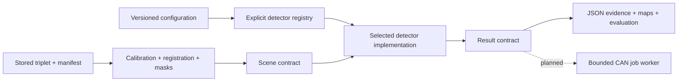

# Replaceable stored-image detectors (pipeline 0.1.0)

This is an **offline development pipeline**. The CAN responder remains payload
0.2.0 with its static stub. This module never opens CAN, camera, mux, or RF devices.



## Stable algorithm boundary

`model.Scene` contains three prepared float32 intensity arrays (`low`, `on`,
`high`), wavelengths, a validity mask, clipping fraction and evaluation-area size.
`model.Detector` specifies `algorithm_id`, `validate(settings)` and
`detect(scene, settings) -> Result`. `Result` contains a Decision enum
(NO_FIRE/FIRE/UNKNOWN), a reason, numerical metrics, region records and optional
array maps. No labels, image filenames, transport objects or file handles cross
this boundary. An algorithm must honor invalid pixels, preserve UNKNOWN for
unusable evidence, and describe its numerical outputs without inventing a
probability of fire.

To add an algorithm, implement this interface in a new module and register its
factory under a new, immutable algorithm ID in `registry.py`. Its own `validate`
method owns the contents of the `detector` configuration section. Select it with
the top-level `algorithm` setting. Acquisition, calibration, registration, CLI
reporting and eventual CAN integration do not select algorithms by conditionals.
Treat prepared arrays as read-only. If an algorithm loads external model
weights, include their hash/version in its evidence as well as its algorithm ID.
The registry is explicit; configuration does not execute arbitrary imports.

Two implementations exercise this seam:

- `spectral_excess_v1`: interpolated continuum, absolute/fractional excess,
  connected candidate regions and coverage/clipping gates.
- `spectral_guarded_v1`: the same decision structure, but each reference channel
  uses its local maximum within `alignment_guard_px` before continuum estimation.
  This conservative reference envelope reduces apparent excess at displaced
  background edges. The validity mask is eroded by the same radius. This also
  reduces sensitivity to small sources; it is not a proof of registration.

Every changed algorithm behavior needs a new ID/version and fresh evaluation.
The test suite demonstrates adding a detector with unrelated settings without
changing the pipeline, as well as the guarded variant rejecting a shifted
background edge while retaining an injected emission region.

## Preparation and scientific limits

The fixture manifest supplies exact paths, dimensions, exposure, camera ports,
wavelengths and file hashes. The calibration file must match the configured hash.
The loader verifies all image hashes and dimensions, applies the gain maps in
sensor coordinates, normalizes to corrected JPEG DN at `reference_exposure_us`,
then registers channels onto the on-line image. ORB/RANSAC fits require inlier
count/fraction, residual, spatial support and common overlap. Failed fits return
UNKNOWN; there is no identity-transform fallback. `prealigned` is only an explicit
profile assertion for already corresponding sensor grids (e.g. synthetic tests),
not permission to skip alignment on arbitrary real fixtures.

The supplied JPEGs have unverified linearity and gain. Profiles must explicitly
opt into exploratory JPEG processing. The October 3 calibration uses 24000-us
darks; this development pipeline deliberately does not subtract them from the
50–800-us fixtures. Dark policy is recorded as `none`, not silently guessed or
scaled. The outer 10% or more of each sensor is masked per calibration notes.
The physical focus/filter compatibility is not established. Every result carries
these warnings, including positive results. These are experimental image scores,
not qualified physical potassium measurements or a deployed fire alarm.

The 107 selected triplets have user-accepted visual labels. Preparation and
inference never use those labels; only evaluation joins them after prediction.
No independent holdout exists, and difficult scenes were excluded. Report all
UNKNOWNs and misses; do not quote a binary accuracy after dropping UNKNOWNs.

## Run from the repository root

```sh
python3 -m venv .venv-detector
.venv-detector/bin/pip install -r firmware/payload/requirements-detector.txt
. .venv-detector/bin/activate
```

Create a virtual environment and install `firmware/payload/requirements-detector.txt`, or use
Debian's `python3-numpy` and `python3-opencv`. Extract
`payload-fixtures-selected.zip` so `manifest.json` and `images/` are siblings.
Obtain `correction_20261003.npz` from the pinned reference repository identified
in the fixture manifest. It is not bundled in Git or the image archive.

```sh
python3 firmware/payload/detect.py \
  --manifest /path/to/fixtures/manifest.json \
  --config firmware/payload/config/stored-images-conservative.json \
  --calibration /path/to/correction_20261003.npz \
  --fixture 20261014_174701_978 \
  --output /tmp/payload-one-run --maps
```

Output must be a new directory. Omit `--fixture` to run all selected cases.
Each case writes `result.json`; `--maps` also writes numerical K/valid/candidate
arrays and a candidate-mask PNG. Evaluation writes `evaluation.json` with every
prediction, confusion counts and UNKNOWN outcomes. Run records include source,
fixture/config/calibration/implementation hashes, dependency versions and timings.
They explicitly report `camera_capture_performed=false`.

The conservative profile is a **development comparison**, selected from a sweep
on these same images. It is not a recommended deployment threshold. Compare the
basic and guarded profiles rather than hiding their error tradeoffs.

```sh
python3 firmware/payload/tune_detector.py \
  --manifest /path/to/fixtures/manifest.json \
  --config firmware/payload/config/stored-images-guarded.json \
  --calibration /path/to/correction_20261003.npz \
  --k 0.5 1 2 --excess 5 7.5 10 --area 8 16 32 \
  --output /tmp/payload-threshold-sweep.json
```

The sweep prepares each scene once and varies only detector settings. It is
specific to the two spectral implementations; a future algorithm supplies its
own tuning dimensions. JSON configuration validation rejects unknown detector
IDs, wrong settings, invalid bounds and nonfinite thresholds.

## Remaining command integration

Keep image processing out of the CAN receive loop. A bounded worker, explicit
busy admission, an analysis deadline, persistent run/check correlation, and a
versioned fixture/UNKNOWN result contract are still required before enabling
commanded image analysis. The current 16-byte result cannot distinguish fixture
analysis from current camera observation. Update IHU/bench/RF/Yamcs consumers
together, and preserve old result decoding. Do not repurpose the existing stub
or mark it ALGORITHM while the live path still returns a fixed answer.

## Prepared Pi development environment

The target test copy is `/home/ngrabbs/ember-detector-dev-20261017` on .253.
It contains the source tree, selected fixtures, calibration and an isolated
`.venv` with NumPy/OpenCV. For a new local analysis (choose a new output path):

```sh
ssh ngrabbs@192.168.1.253
cd ~/ember-detector-dev-20261017
.venv/bin/python firmware/payload/detect.py \
  --manifest fixtures/manifest.json \
  --config firmware/payload/config/stored-images-conservative.json \
  --calibration correction_20261003.npz \
  --fixture 20261014_163143_865 \
  --output /tmp/payload-detector-example-001 --maps
```

This is independent of `/opt/ember-payload`; keep the live responder under its
existing service. The development CLI sends no CAN commands. To swap detectors,
use another configuration file with the registered algorithm and its settings.
