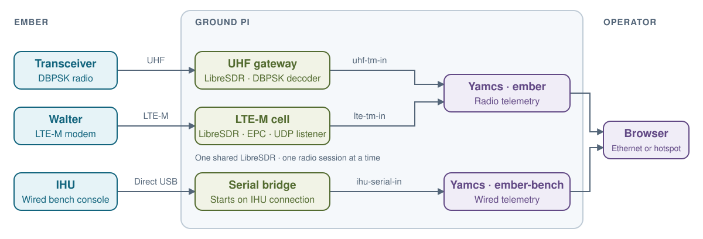

# Ground station

A Raspberry Pi 5 runs Yamcs and the services that receive EMBER telemetry.
Operators use a browser over lab Ethernet or the Pi’s `EMBER-Ground` hotspot.

## System at a glance

[Editable diagrams.net source](architecture/ground-station.drawio)

- **UHF** carries telemetry and supported commands between Yamcs and EMBER’s transceiver.
- **LTE-M** carries Walter telemetry through a separately started lab cell. UHF and LTE-M use LibreSDR one session at a time.
- **Direct USB** connects the IHU console to the ground Pi. The serial bridge starts on connection and feeds the separate wired bench instance.

## Guides

[Demo checklist](DEMO.md) · [Yamcs operator guide](yamcs/README.md) ·
[Pi setup and recovery](pi/README.md) · [Release records](releases/README.md)

[UHF receiver](bpsk/README.md) · [LTE-M runbook](lte/README.md) · [SDRB bench](bench/sdrb/README.md)
