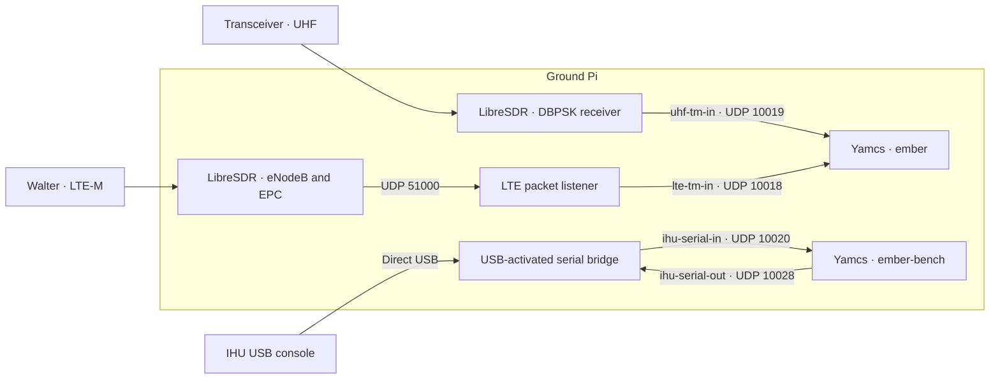

# Ground station quick start

Power on `ember-ground` and connect LibreSDR. Open Yamcs on
[lab Ethernet](http://192.168.1.251:8090), or join `EMBER-Ground` and open
[Yamcs on the hotspot](http://192.168.50.1:8090).

## System at a glance



Yamcs and readiness supervision start at boot. Readiness starts the LTE
packet listener when it detects LibreSDR. Start the UHF receiver or the LTE
cell when needed. Use one radio session at a time on the shared LibreSDR.

For wired bench commands, plug the IHU USB console into the Pi and select
**ember-bench / realtime**. The Pi starts the serial bridge for the registered
IHU and disables the wired links when it disconnects. See
[console ownership and setup](yamcs/OPERATIONAL.md#serial-ownership-and-eps).

## Receive UHF

1. On the ground Pi, check `systemctl status ember-fire-uplink`. If it is
   running the continuous UHF gateway, use its `uhf-tm-in` feed. For a manual
   capture, release LibreSDR first, then use the
   [EMBER DBPSK profile](bpsk/README.md#live-uhf-demo-receiver).
2. From the repository root on the Pi, run this example for the 437 MHz bench
   carrier. Use a new output directory for each run.

   ```sh
   python3 ground/bpsk/live.py --seconds 90 --frequency 437000000 --gain 0 \
     --forward --output "/tmp/ember-uhf-$(date -u +%Y%m%dT%H%M%SZ)"
   ```

3. Wait for `BPSK_RX_READY`, then request telemetry using the procedure for
   the installed [transceiver build](../firmware/transceiver/README.md#commands).
   Look for `BPSK_RX_PACKET` and keep the run's `packets.jsonl`.

## Receive LTE

1. On the ground Pi, check the listener. With LibreSDR attached, readiness
   normally starts it. If it is inactive, start it and recheck its status.

   ```sh
   systemctl status ember-lte-listener
   sudo systemctl start ember-lte-listener
   ```

   The service owns UDP `51000`. The [Pi runbook](pi/README.md#status-and-recovery--pi-ssh-shell)
   covers troubleshooting and handing that port to a manual trial.
2. With LibreSDR free, bring up the lab EPC and eNodeB using the
   [LTE-M runbook](lte/BRINGUP.md#5-bring-up-lte-m).
3. Follow the [Walter bench check](../firmware/walter/README.md#how-lte-telemetry-reaches-yamcs)
   to open the LTE window from the IHU, wait for registration and READY, and
   send a packet. The Pi logs arrivals in
   `/var/lib/ember-lte-listener/packets.jsonl`.

## Verify packets in Yamcs

1. Select **ember / realtime** and check the receive counter for **uhf-tm-in**
   or **lte-tm-in** on the Links page.
2. Open **Telemetry → Packets**, refresh, and find the expected packet by its
   receive time. Compare its bytes with the receiver log. Identical packets
   arriving over both links can share one archive entry.
   [Yamcs packet viewer](https://docs.yamcs.org/yamcs-server-manual/web-interface/telemetry/#packets)

[Pi provisioning and recovery](pi/README.md) ·
[Yamcs deployment](yamcs/OPERATIONAL.md) ·
[Release records](releases/README.md)
