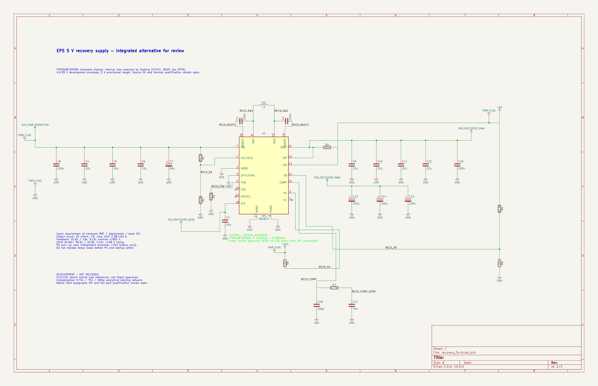

# Integrated 5 V recovery development study

This isolated KiCad 10 project evaluates TPS552872RYQR for EPS Rev B. Read the [design rationale and remaining closure gates](../../design/rev_b_5v_recovery_design.md) before using it. It is a review candidate, not an accepted 2 A rail or fabrication release.

- Open `recovery_5v.kicad_pro` for the one-sheet ANSI B schematic. Library tables resolve project-owned parts through portable `${KIPRJMOD}` paths.
- `recovery_5v.kicad_pcb` contains **only the disposable U1 package comparison**. It does not represent circuit placement, connectivity, routing, or an EPS board layout.
- `development_bom.csv` includes reference parts and explicitly unfinished MPNs/footprints. It is not an ordering or assembly BOM.
- `physical_pin_map.csv`, `package-readback.xml`, and `package.png` document the provisional TI RYQ0021A land pattern. Pad 9 uses three constituent lands; stencil and thermal acceptance remain open.
- `erc.json` is the direct KiCad CLI report. The saved schematic passes ERC with zero errors and zero warnings. [Endpoint and net-class evidence](../../verification/evidence/2026-10-23_recovery_5v_verified.json) and [fresh wire geometry](../../verification/evidence/2026-10-23_recovery_5v_geometry.json) are separate checks.

The actual page, input, controller, output, and package exports were visually inspected. The bright-green custom review callout is the user-approved alternative to unsupported body coloring; the custom part remains unreviewed. Required S11 parameter-block font, visibility, and positioning are not accepted because the exposed Konnect field API cannot implement/verify them.



Regenerate the analytical evidence from the repository root:

```sh
python3 hardware/eps/verification/recovery_5v_analysis.py
```

The averaged model is an engineering estimate; it excludes switching dynamics, transition/PFM behavior, and startup. No bench or thermal qualification has run. Heavy-load release, protected source voltage, exact passive selections, and independent rail fault containment remain open.
