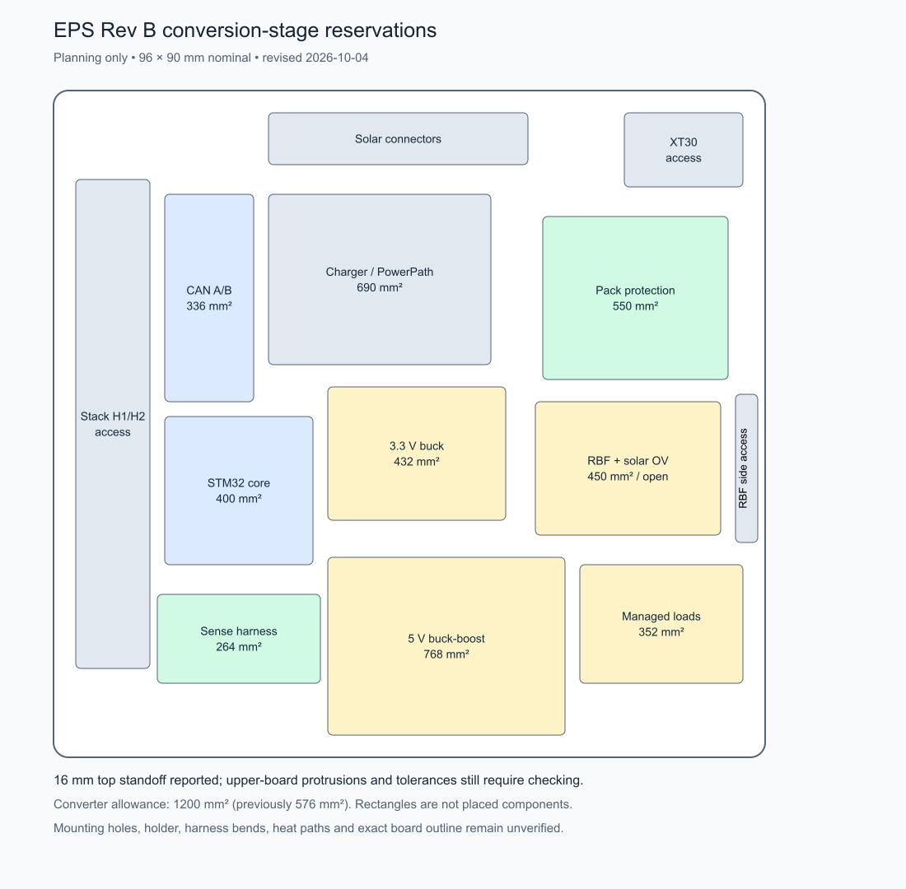
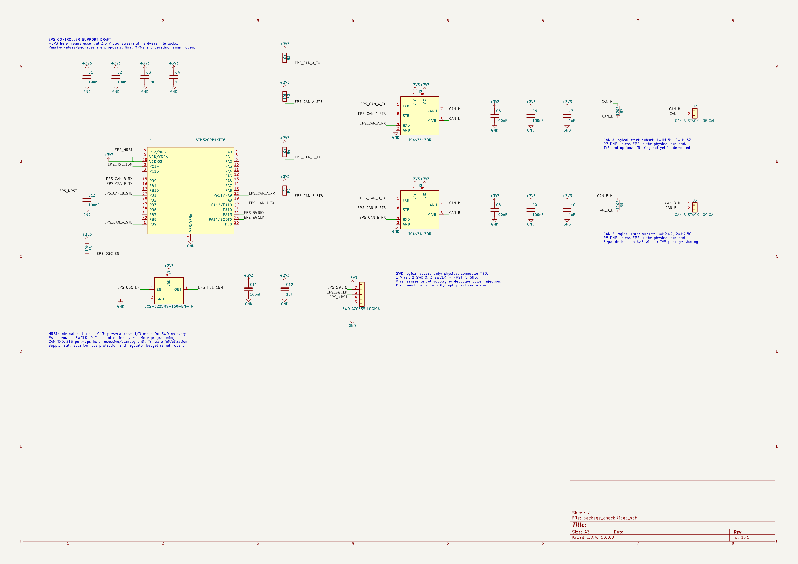

# EPS verification checkpoint

- [Tracked controller rebuild](controller_rev_b/native/README.md), 2026-10-23: corrected stock STM32G0B1KET6N, two linked B sheets, 20 checked endpoint sets and 22 selected parts among 27 physical parts. ERC has 18 integration errors and 3 isolated-interface warnings; both actual pages and details were inspected. This supersedes the earlier scratch controller's current-status claims below.
- [Charger thermistor analysis](charging/README.md): independently checked ADC divider equation, leaded sensor candidate and threshold/tolerance sensitivity. Native charger circuit and physical Rev A diagnosis remain open.
- [Whole EPS completion ledger](../design/rev_b_completion.md): integrated schematic and authorized Rev B PCB stages, with hardware acceptance kept separate.

- [Selected source and 5 V protection circuits](../design/rev_b_5v_recovery_protection_selection.md): complete development circuits, transient/SOA screening, rejected arrangements and remaining qualification limits. [Native evidence](protection/native/README.md) separately records 40 endpoint sets, 0 ERC errors / 1 external reset warning and actual rendered-sheet inspection; S11 presentation remains open.

- [Panasonic D8/F recovery bulk footprints](panasonic_bulk_footprints.md): approved construction, exact land/polarity/courtyard query-back, independent saved-board export and actual renders. Construction checks pass; fabrication-text and assembly qualification remain open.

This directory records the Rev A audit and the isolated Rev B controller study. It is a design checkpoint, not a qualified schematic or fabrication release. The fabricated Rev A KiCad files are unchanged by this PR.

- [5 V recovery design](../design/rev_b_5v_recovery_design.md): integrated TPS552872 alternative, editable B-sheet study, analytical compensation and 16 verified functional nets. Electrical draft passes ERC; qualification, final passive BOM and field presentation remain open.
- [Essential buck stage draft](essential_buck_stage_draft.md): TI-derived six-pin package, hardware enable and passive circuit, six verified net endpoint sets, one classified ERC finding, and 5 V bias/startup constraints.
- [Power-stage sizing and fit](../design/rev_b_power_stage_sizing_and_fit.md): reproducible load/ripple/sense calculations, package readbacks, 16 mm top standoff and expanded conversion reservations.
- [Regulator and OV candidates](../design/rev_b_regulator_and_ov_candidates.md): 3.3 V buck / 5 V buck-boost preference, operator recovery requirement and cutoff restart constraint.
- [Source voltage and fault budget](../design/rev_b_source_voltage_and_fault_budget.md): cold-array calculation, regulator replacement recommendation, capacitor reconciliation and continuous CAN fault requirements.
- [Rev A saved-schematic audit](rev_a_saved_schematic_audit.md): release/export disagreement and unresolved charger thermistor diagnosis. Physical measurements remain necessary.
- [STM32 GP candidate verification](stm32_gp_candidate_verification.md): package-specific pin mapping and manufacturer-pattern checks.
- [CAN and oscillator package candidates](controller_package_candidates.md): package review and historical verification snapshots.
- [Current controller support draft](controller_support_draft.md): decoupling, reset and control-pin bias, exact endpoint verification and remaining work.
- [CAN TVS candidate verification](can_tvs_candidate_verification.md): verified lead/pad identity, unresolved land-pattern acceptance and fault review; controller population remains pending.
- [Current CAN stack-interface draft](controller_can_interface_draft.md): separate bus nets, optional termination and protection placement gates.
- [SWD access checkpoint](controller_debug_draft.md): logical debugger interface, endpoint checks and diagnostic disagreement.
- [Candidate library status](../libraries/README.md): active draft IDs and acceptance limits.

## Historical scratch controller result

The current CAN-interface netlist matches the intended endpoints on all 17 named nets. Earlier debug and support-only checkpoints covered 13 and 11 nets. Konnect reports zero floating wire endpoints and zero merged named nets. Manufacturer-pattern exports were checked for all 44 pads across the MCU, two CAN transceivers and oscillator.

Current ERC reports **20 errors**: 19 unfinished MCU pins and one undriven supply. Component and orphan queries agree on the unfinished-pin count. The previous SWD diagnostic disagreement remains documented in that historical report. The earlier 26-error support-only and 48-error signal-only results are historical. The physical debug connector and recovery tests, remaining MCU interfaces, full stack integration, termination ratings/population and TVS protection, source isolation, regulation, final parts and layout remain unfinished. No bench or firmware qualification has run.

## Review previews

[Controller support PDF](previews/package_check_controller-support-draft_1791114867.pdf).

The previews were exported from a disposable study outside the repository. This PR includes its candidate libraries, saved netlists and verification evidence, but does not include the scratch native schematic/PCB. The scratch PCB is a package comparison and is not synchronized with the support schematic or suitable for fabrication.

Machine-readable exports and readbacks are under [evidence](evidence/). Local scratch paths in individual reports record provenance; use the repository previews above for review.
