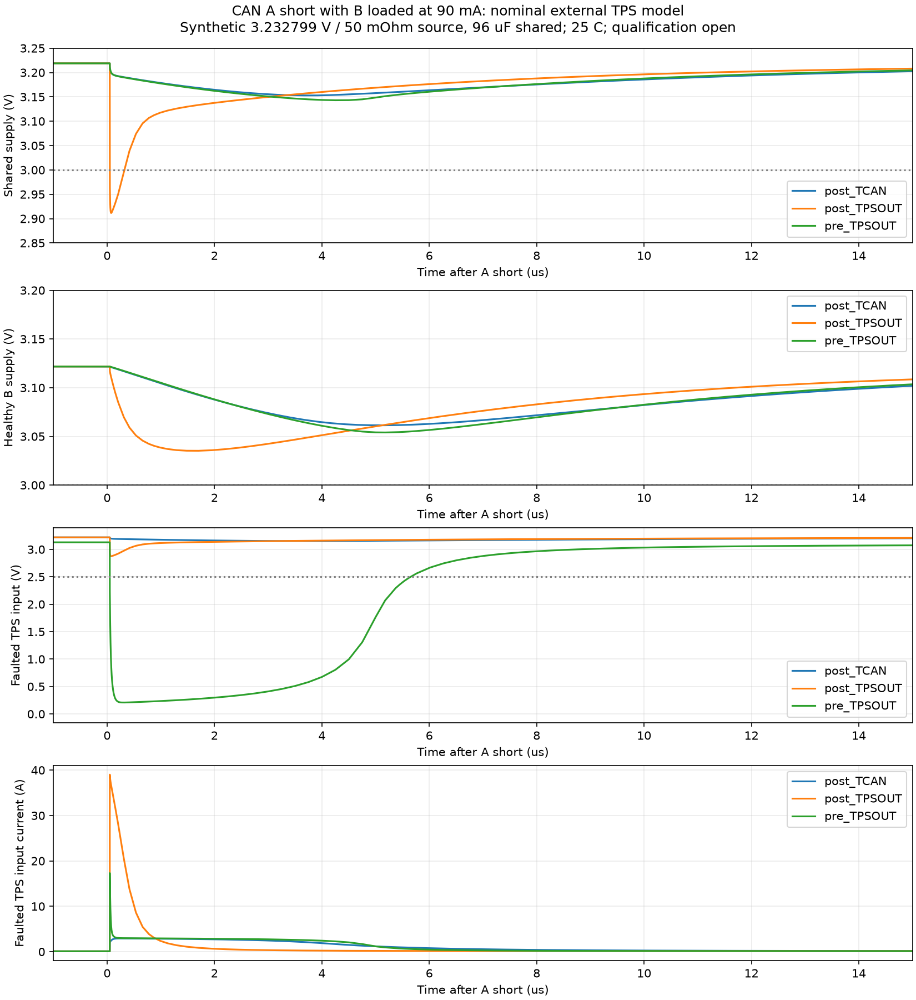

# Coupled CAN branch fault-location screen

2026-10-24. **Six completed nominal model runs; no native CAN branch integration and no guaranteed A/B recovery claim.** The approved TPS2553DBVR-1 package remains available. These runs refine the earlier [branch proposal](../branch_selection/README.md), particularly its resistor placement and fault coverage.

## Fixture and model limits

Two TPS2553-1 instances share an imposed 3.232799 V source through 50 mΩ and 96 µF / 10 mΩ ESR. An additional 100 mA load represents other essential consumers. Each branch has 210 kΩ ILIM, 100 nF local input bypass and 1.2 µF / 20 mΩ ESR local transceiver reservoir. Each synthetic transceiver load draws either 60.965 or 90 mA above 2.7 V, then decreases linearly with voltage. This is **not** a TCAN behavioral model or a measured traffic profile. The shared source is not the LMR51635 control loop, and 96 µF is an assumed effective value, not a newly qualified floor.

The A short is an ideal contact with 10 mΩ on resistance, asserted at 10 ms and released at 30 ms. Both EN inputs are driven low from 35 to 55 ms, then released; common timing makes reset visible but does not allocate a real reset interface or prove independent control. All runs are 25 °C, 60 ms long, and have both a completed-log marker and the expected raw-file end time. [results.json](results.json) records extrema, reset samples and raw/log hashes; full raw/log files remain in `/tmp/ember-can-coupled-20261024`.

The external [TI SLVM426 model](https://www.ti.com/lit/zip/SLVM426) hash is `2c4436b54cf8efc9dd522e110708fcb942e741a9620d6f442c577f787f451622`. It uses only the previously [truth-checked PSpice XNOR syntax adapter](../../bms/tps2553_transient/README.md); adapted hash `354d0e0c2e67a8d750fb0c1174b98e369139719d69d4d0df027b6d7ce9ef22f9`. No manufacturer model is redistributed. Do not read a nominal macro's initial current as a guaranteed physical peak or minimum/maximum response time. The [TPS2553-1 datasheet](https://www.ti.com/lit/ds/symlink/tps2553-1.pdf) still has no guaranteed maximum short-response delay at this 3.3 V operating point.

## Comparison

“Post” places 1 Ω between TPS OUT and the transceiver bank, following the old proposal. “Pre” moves 1 Ω before the TPS input bypass and switch. Both modeled channels use the same arrangement. The 1 mΩ fixtures replacing the absent resistor are modeling wires, not BOM items.

| Each normal load | Resistor / A fault location | Shared minimum V | Healthy B minimum V | A TPS input peak A |
| --- | --- | ---: | ---: | ---: |
| 60.965 mA | Post / transceiver rail | 3.1550 | 3.0948 | 2.925 |
| 60.965 mA | Post / TPS OUT, before resistor | 2.9140 | 3.0691 | 39.04 |
| 60.965 mA | Pre / TPS OUT | 3.1450 | 3.0874 | 17.45 |
| 90 mA | Post / transceiver rail | 3.1529 | 3.0614 | 2.922 |
| 90 mA | Post / TPS OUT, before resistor | 2.9115 | 3.0352 | 39.01 |
| 90 mA | Pre / TPS OUT | 3.1430 | 3.0540 | 17.31 |

All six nominal runs assert A FAULT about 7.5 ms after the short, latch A off and restore its output after EN cycling. B FAULT stays high in these runs. The 59 ms B voltage is approximately 3.156 V at 60.965 mA and 3.122 V at 90 mA. Neither finding establishes a full-temperature transceiver, MCU or oscillator timing margin.

**The downstream 1 Ω resistor does not cover a short directly at TPS OUT.** That short produces the larger modeled pulse and shared-rail dip. The healthy branch's local capacitor/resistor temporarily holds its voltage above the shared node; the shared 2.91 V minimum cannot be ignored merely because B stays above 3 V in this fixture. Other consumers and their fault/UVLO responses still matter.

**Moving the resistor upstream is not yet an accepted fix.** It reduces the imposed source's peak current and disturbance, but the faulted TPS input falls to approximately 0.209 V, well below its 2.5 V recommended operating minimum, before recovering. Its 100 nF input capacitor can discharge locally through the switch, explaining why the switch-current peak remains much larger than the upstream source current. Nominal latch behavior during that collapse is not a guaranteed timing/UVLO result. An input-to-ground failure before the switch also bypasses its own latch and needs separate containment. Resistor placement alone does not solve every internal component fault.

The four-panel plot was opened and inspected: shared voltage, healthy B voltage, faulted switch input and A input current at the 90 mA load. Vmon is directly before TPS IN, after its external bypass; it is not a direct OUT/FET-drain current probe. The CSVs retain each selected channel's bucket extrema rather than uniform decimation. They are compact waveform evidence, not the full raw data. Normalized completion logs are retained under `logs/`; result hashes refer to the unchanged external originals.

## Execution and next integration boundary

`run_screen.py --model <exact external TI lib> --output <new external directory>` runs all six cases sequentially with a 45 s process bound each. Use Python with numpy. `plot.py --raw-dir <completed directory>` additionally requires matplotlib; it checks raw hashes before plotting. This run used the bundled Python 3.12 runtime, with matplotlib installed only in `/tmp/ember-plotting-deps`; it changed no global Python installation. Portable decks use `${TPS_ADAPTED_MODEL}` and preserve the model's simulation-port order, which differs from physical DBV lead order.

Before native branch integration, select the fault scope/resistor arrangement explicitly and complete a pin-preserving reset/control circuit. The selected STM32's former reserve pins are already used by the isolated-BMS supply; four independent direct CAN EN/FAULT GPIOs cannot be assumed available. Reusing each existing standby control for branch reset/power mode is an option to analyze, with startup, off-state logic feeds and loss of standby wake reception documented before selection. No existing interface is migrated here.

Then verify the complete graph, actual rendered CAN/control sheets, effective capacitance, normal traffic loading, initial short response and resistor pulse stress, real essential-regulator response, brownout/retry behavior and all-path off-state injection. GPIO/clock sharing and faults inside the branch switch remain common-cause concerns. The present data support a development comparison, not a surviving B bus under arbitrary A-side failure.
