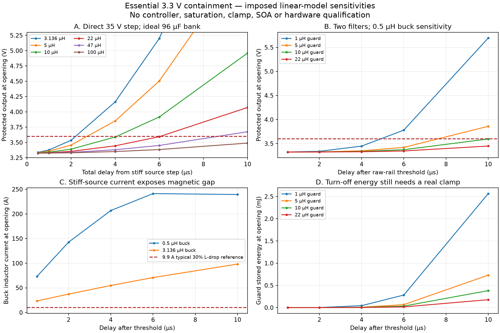

# Essential 3.3 V protection design window

2026-10-24. Read-only circuit feasibility evidence at the318-part SWD checkpoint. **No protection circuit is selected or integrated.** This record narrows the next design choices; it does not accept the existing unprotected rail. All207 tracked native CAD/library files remain unchanged.

## Decisions supported by this evidence

The converter's current C404–C411 bank is eight GRM32ER71E226KE15L22µF/25V parts, directly on its output. A downstream barrier alone leaves that bank exposed to the35V high-side-short scenario. The next circuit must either replace the upstream bank with a fault-voltage-rated bank (50V is the current candidate class), or provide a verified interruption ahead of it. Preserve a stable converter feedback/filter path when the downstream barrier opens. Moving the only output bank downstream of a switch without reviewing regulator stability is not accepted. A proposed additional protected bank in the models below is **not currently fitted**.

The LTC4365 stock symbol remains available, but it is not selected. ADI RevB gives gate-drive limits at VIN=VOUT=5V and12–34V; a typical curve at low voltage does not establish the corresponding3.3V guaranteed drive. Its specified maximum propagation-delay row is at12V/50mV comparator overdrive, not the intended3.3V point. Exact low-voltage drive, gate load and complete detection-to-interruption delay must precede a MOSFET selection. Merely choosing a MOSFET by its threshold voltage is insufficient.

Two independent-divider screens include0.1% initial resistance,25ppm/K over65K, reference492.5–507.5mV and±10nA input-leakage assumptions:

| Top / bottom | Rising trip window | OV pin at35V, ratio corner | Disposition |
| --- | ---: | ---: | --- |
|58.8k /10k|3.37265–3.50790V|5.11008V|Exceeds5V OV absolute limit without a separately designed clamp; reject this unclamped implementation|
|60.4k /10k|3.45102–3.58954V|4.99403V|Only10.46mV static margin to the working3.6V ceiling and5.97mV to OV-pin absolute limit at the exact imposed35V source; no transient acceptance|

The source's actual tolerance/ringing must also be included;4.994V is not a robust clamp design. A separately protected sense input and tighter threshold/response path may be needed. An input clamp must not back-feed the protected rail.

Powering a protection controller from `SYS_PWR_PERMITTED` is an alternative worth checking, but **does not by itself close the LTC4364 accuracy gap**: its FB servo accuracy row covers VCC12–80V, while battery/SYS operation includes5–8.5V. Any auxiliary-bias proposal must work autonomously and obey RBF; there is no accepted always-on bias exception.

## Direct-step delay and charge screen

`calculate.py` solves the underdamped RLC step in closed form for504 combinations. Initial rail3.324392V comes from the existing static corner file; source steps instantly to35V. EffectiveL, effectiveC, series resistance and ideal total opening delay are imposed sensitivities. The switch is assumed to open instantly after the inductor, without parasitic feedthrough. Output ESR/ESL, saturation, real gate drive and turn-off clamps are absent.

With96µF andzero series resistance, the time from the imposed stiff step to3.6V is2.291µs at3.136µH,4.090µs at10µH, and6.067µs at22µH. At3.136µH,2µs gives3.5346V and4µs gives4.1624V. The96µF bank has only26.46µC of charge headroom from the static high corner to3.6V. These quantify the imposed boundary; they **do not prove every real converter fault requires those same inductances or delays**. The actual converter filter can substantially slow that source transition.

Conditional2A DC-drop examples are also retained. An assumed108mΩ MOSFET pair plus30mΩ other path resistance would leave2.9568V at the existing3.2328V static low corner. No hot resistance or gate-drive guarantee is inferred from that sensitivity. Rail headroom must be checked alongside transient protection.

## Stage-resolved linear fault screen

`staged_fault.py` integrates240 cases with two LC stages: the failed-short converter's inductor and96µF raw bank, followed by a proposed guard inductor, ideal disconnect and48/96/192µF protected bank. The raw rail trips at the first divider's3.507897V upper corner; opening follows an imposed0.5–10µs total delay. Two buck inductance sensitivities are3.136µH and0.5µH, guard inductance1/5/10/22µH, load0/2A. The0.5µH value is **not a guaranteed saturated inductance**.

For0.5µH buck /96µF protected /no load /6µs delay,1µH guard yields3.77986V at opening;5µH yields3.42104V and10µH yields3.37308V. At10µs, the10µH case reaches3.59608V, leaving less than4mV before omitted effects. It is not a selected or accepted design. In that same stiff-source case, modeled buck current is approximately240A, far beyond the existing inductor's9.9A **typical30%-drop reference**. Thus even the apparent voltage pass cannot establish a real magnetic or source-current bound. A bounded source/fault reservoir and an actual high-current magnetic/energy path are necessary before circuit acceptance.

The ideal switch retires each fixture at opening. Guard stored energy is reported separately; a real turn-off clamp and MOSFET voltage/current/time trajectory must absorb/control it. The model does not transfer that energy into the protected capacitor by assumption, nor prove that a real circuit avoids such transfer. The unprotected raw bank, converter inductor, input reservoir and source protection may require coordinated fault containment as well as a downstream logic barrier.

216 of240 imposed two-filter cases stay below3.6V at ideal opening. This count is scenario coverage, **not a protection pass rate**. It neither validates a controller nor closes startup, feedback stability, short-circuit behavior, SOA, thermal or physical fit.

## Verification and reproduction

Use Python with NumPy for `staged_fault.py` and `verify.py`; plotting also needs Matplotlib. No external semiconductor model is modified or decrypted.

```
python3 calculate.py
python3 staged_fault.py
python3 staged_fault.py --step-ns 1 --output staged_repeat.json
python3 verify.py
python3 plot.py
```

The2ns and1ns RK4 runs differ by at most0.557µV in protected output. An independently formulated4×4 matrix-exponential solution checks every staged case, including first-threshold timing and opening states. Maximum mixed voltage/current state difference is3.49×10⁻⁵ and trip-time difference0.585ps. The verifier also checks native-source byte preservation. These establish numerical consistency of the stated equations, not fidelity to hardware. The direct zero-resistance solution is independently checked against its analytic cosine form.

Electrical calculations are separate from visual evidence: root opened and inspected all four final plot panels. No new schematic sheet or manufacturer reference-circuit render is claimed. The fresh Konnect library query finds stock LTC4365TS8 with eight physical pins; LTC4367 returns zero registered matches. No library construction or approval is requested at this feasibility stage.

Primary sources reviewed as web text: [ADI LTC4365 RevB](https://www.analog.com/media/en/technical-documentation/data-sheets/LTC4365.pdf), pp3–4 and9–10; [ADI LTC4367 RevD](https://www.analog.com/media/en/technical-documentation/data-sheets/ltc4367.pdf), pp3–4; [ADI LTC4364 RevB](https://www.analog.com/media/en/technical-documentation/data-sheets/ltc4364-1-4364-2.pdf), electrical characteristics; [TI CSD18543Q3A](https://www.ti.com/lit/ds/symlink/csd18543q3a.pdf). Current regulator/passive sourcing and conditional bounds are preserved in the earlier essential-3V3 native checkpoint.3.6V is a working normal-operation ceiling, not a shared absolute-maximum claim for every consumer.


