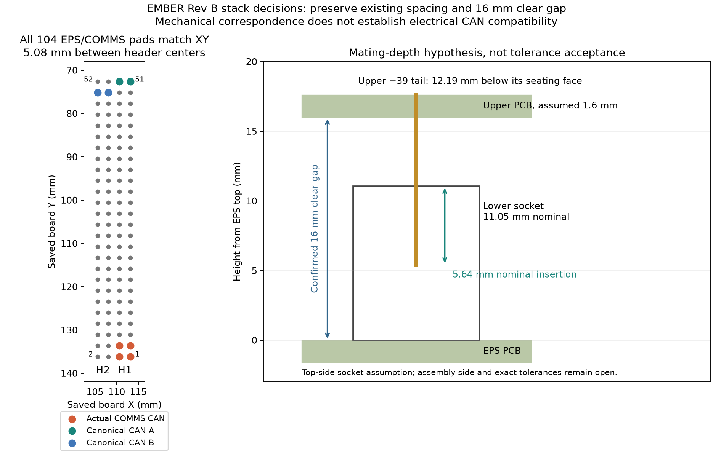

# EPS stack-interface geometry reconciliation

2026-10-24. Read-only geometry and interface evidence. The operator confirms **16 mm clear gap between the EPS top surface and next PCB underside** and explicitly chooses to **retain5.08 mm H1/H2 center spacing**, documenting an EMBER mechanical exception to Pumpkin compatibility. This is a requirements decision, not mating/clearance or flight acceptance. No EPS/COMMS board geometry was changed.

Fresh Konnect closed-file readbacks compare all52 pads on each header in saved EPS Rev A and current COMMS. All104 coordinates match within3×10⁻¹⁴ mm after normalizing leading-zero pin numbers. Centers in the existing board coordinate system are H1(111.9436,104.3736) and H2(106.8636,104.3736) mm. EPS sockets are on the bottom; COMMS sockets are on top. Matching XY does not prove a mating assembly, electrical compatibility, mounting-hole alignment or the intended Rev B assembly side.

The primary [Pumpkin PCB specification810-00253 RevA5](http://www.cubesatkit.com/docs/CSK_PCB_Spec-A5.pdf), sheets1–3, was downloaded directly overHTTP after HTTPS retrieval failed and actually inspected. Its top-view connector pin1 coordinates share X=.550in and have Y=3.575/3.275in: **7.62 mm separation**. Sheet2 is the rounded metric rendition. It provides dimensioned geometry that the repository motherboard datasheet's simplified p5 outline lacks. The existing5.08 mm EMBER pair therefore cannot be called mechanically Pumpkin-compatible merely because it uses the same connector family.

## Connector and height evidence

[Samtec ESQ print RevCM](https://suddendocs.samtec.com/prints/esq-1xx-xx-x-x-xxx-xx-x-xx-mkt.pdf), all four sheets, [ESQ-SDT footprint](https://suddendocs.samtec.com/prints/esq-sdt.pdf) and [catalog F-226,16June2026](https://suddendocs.samtec.com/catalog_english/esq_th.pdf) were rendered and inspected. The published double-row hole pitch is2.54 mm and recommended hole1.02 mm. The COMMS project footprint has52 unique1.8 mm copper lands/1.02 mm drills and explicit CSKB logical numbering; its older odd-right audit is superseded by its later odd-left correction. This is an available project footprint, absent from globally registered search results, rather than a missing-part conclusion.

The current catalog gives11.05 mm socket height,12.19 mm −39 tail,2.29 mm −37 tail and3.68–6.35 mm insertion depth. The print's −37 table has a conflicting2.87 mm metric tail beside.090in; do not silently accept that entry as2.29 mm. The current catalog and exact product description agree on2.29 mm, but exact endpoint dimensional acceptance remains pending.

For top-mounted sockets, an upper board of thickness `t`, facing-surface gap `g`, lower socket height `C`, and upper tail `B`, the geometric insertion is `i=B−t−g+C`. With the confirmed16 mm gap and **assumed1.6 mm upper PCB**, nominal insertion is5.64 mm. If16 mm had meant same-face spacing it would instead be7.24 mm, illustrating why the user clarification mattered. The upper-board thickness is not yet accepted.

A deliberately conservative sensitivity derives upper tail from print dimensions `D−Cupper`; independent±0.25 mm dimensions, illustrative±0.10 mm PCB thickness and±0.10 mm gap give4.69–6.59 mm insertion. That exceeds the catalog upper depth, so nominal arithmetic is **not a tolerance-stack pass**. Obtain the exact lead/seating tolerances and actual boards/standoffs before mechanical release. Do not change the user's16 mm requirement on the strength of assumed tolerances.

At5.08 mm centers, the4.95 mm reference body width leaves only0.13 mm nominal gap; that reference dimension is not a guaranteed maximum. Existing individual5.95×67.55 mm courtyards overlap0.87 mm. A pair's rectangle union is745.0765 mm² versus803.845 mm² summed rectangles. These are reservation arithmetic, not permission to erase courtyard violations or pack components into a demonstrated clearance. Final paired-socket body, flash, solder and assembly access require actual envelope checks. The −39 footprint/3D tail is not automatically an exact −37 endpoint representation.

## Electrical mismatch found during geometry work

The saved COMMS board has H1.1=`CAN_A_N`, H1.2=`CAN_B_N`, H1.3=`CAN_A_P`, H1.4=`CAN_B_P`. Its canonical CAN positions H1.51/52 and H2.49/50 are unconnected. These are actual pad-net readbacks, not an inference from an old drawing. The operator's spacing approval changes **mechanics only**; it does not allocate reserved pins1–4 or authorize an EPS CAN remap. Keep EPS Rev B on canonical H1.51/52 and H2.49/50. Record a COMMS electrical revision and verify IHU/payload peers before claiming stack CAN recovery. No COMMS native change was made.

The old EPS board supplies raw `/BATT_POS` to H2.45/46 and has no implemented flight cutoff. Rev B must still implement the specified protected/interlocked/managed `VBAT` feed; matching connector coordinates does not close that power-isolation gap.

## Reproduction and scope

[calculate.py](calculate.py) independently checks all104 coordinate pairs, all52 existing-library pad geometries, source-file hashes, spacing, height sensitivities and the actual peer-CAN mismatch. [results.json](results.json) retains every pad coordinate/net and the explicit operator decisions. [Konnect readbacks](konnect_readback.json) retain raw responses with `source=file`; the library is resolved from the COMMS project by exact path. Before relying on the results for a later revision, requery current boards; hashes bind this checkpoint only.

Two CLI IPC-2581 exports independently corroborated package/placement metadata; full exports stay outside Git and their hashes are recorded in sources.json. Their geometry excerpts are retained in ipc_excerpts.json. Source PDF hashes, paths/URLs and inspected pages are in sources.json. This folder authors no new KiCad part and places no production header. Electrical evidence, source-page inspection and final mechanical/PCB acceptance remain separate.

