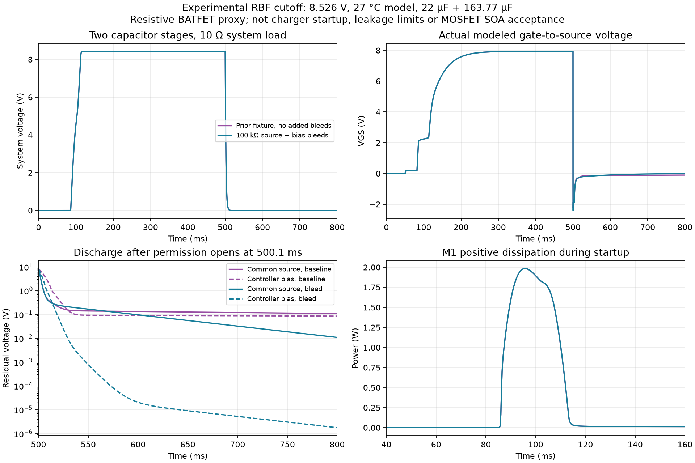

# RBF controller retained-power screen

2026-10-24. **Experimental circuit evidence; no RBF circuit, contact assembly or MOSFET is selected or integrated.** Eight complete LTspice 26.0.2 runs and one repeated run refine the [earlier common-source controller study](../controller_screening/README.md). The current EPS remains305 parts/166 nets/826 endpoints across12 sheets. All202 tracked native CAD/library files are unchanged.

## Boundary interpretation

The [LTC4367 Rev D datasheet](https://www.analog.com/media/en/technical-documentation/data-sheets/ltc4367.pdf), pp.7 and14–15, states that shutdown can accommodate separately driven VIN/VOUT and holds GATE below the lower supply. VOUT also supplies its charge pump above approximately5 V. The tabulated shutdown pin currents use VIN=VOUT; they are not guaranteed arbitrary partial-power limits. **Our VOUT connection to the internal common-source node remains a material application deviation.** These statements support further study, not acceptance of that deviation.

For the N-channel common-source pair, each intrinsic body diode points **from common source toward its external drain**. The two energized external ports therefore do not intentionally diode-feed common source with the channels off. This differs from a P-channel common-source pair. Positive internal VOUT after opening the permission contact can represent stored charge; it does not by itself establish an always-powered raw-bus controller. Conversely, the diode orientation does not eliminate drain leakage, capacitive coupling, contact leakage or unintended pin feeds. Those can replenish an internal reservoir and require guaranteed limits.

The candidate keeps the controller VIN supply behind the physical permission contact. The source-port diode OR, contact and MOSFET drains are upstream; no active raw-bus bias supply is intentionally added. UV and SHDN follow permission; the isolated bias reservoir permits turn-off after permission falls. Two additional100 kΩ bleeds, one common-source-to-ground and one bias-to-ground, improve discharge. At8.526 V their individual resistive load is at most85.26 µA/0.727 mW if the resistor sees that full voltage; this is arithmetic, not a complete quiescent/leakage budget or selected resistor rating. Battery and PV barriers still need separate controls and hardware paths.

## What was actually modeled

Four startup/permission-loss fixtures compare the earlier network with the two bleeds, with power entering either port. They use8.526 V,50 mΩ source resistance,1 µH harness,1 µF input capacitance, a1 µs source edge and a10 Ω system load. Permission rises at50–50.1 ms and opens at500–500.1 ms. The0.8 s runs save full-resolution raw data, maximum step10 µs. All logs report **27 °C**, not a temperature-corner qualification.

The direct battery bank is22 µF and the system bank163.77 µF, separated by a **25 mΩ resistive BATFET proxy**. These are the [initial-tolerance upper inventory values](../source_boundary_2026_10_24/README.md), not guaranteed all-condition capacitor maxima. This preserves two capacitor nodes but does **not** model LTC4162 startup, BATFET gate/body-diode behavior, charger control, converter startup, constant-power loads or the solar filter/PowerPath network. It is an intermediate boundary experiment, not the complete stage-resolved EPS startup model. Reversing the identical MOSFET pair is a symmetric fixture permutation, not independent device-corner coverage.

Four more fixtures hold permission open throughout, with independently forced port voltages(A,B) of(8.526,0),(0,8.526),(8.526,8.526) and(35,0) V. All use the added bleeds. The35 V case is **inhibited only**, with no PV current-limit model or accepted source envelope; harness ringing reaches approximately63.65 V MOSFET stress. Do not treat that result as an arbitrary35 V hot-plug, solar-startup or transient-clamp pass.

The installed unmodified LTC4367 and IRLR2908 models are identified by hashes in [results.json](results.json). The diode D100 and SWC contact remain generic assumptions with no selected MPN. Model files and large raw outputs stay outside Git. No encrypted model was modified or decrypted.

## Results and limits

| Observation | Earlier fixture | Added100 kΩ bleeds |
| --- | ---: | ---: |
| Common source,750–800 ms |108.852–114.358 mV |10.851–18.725 mV |
| Controller VIN bias,750–800 ms |85.293–86.763 mV |1.755–3.022 µV |
| Gate/source over complete startup and turn-off |−2.383 to+7.938 V |−2.513 to+7.938 V |
| Gate/source,750–800 ms |−110.118 to−104.728 mV |−18.720 to−10.849 mV |
| Positive M1 dissipation integrated over complete run |46.975 mJ |47.018 mJ |
| Positive M2 dissipation integrated over complete run |6.013 mJ |6.014 mJ |

Forward and reversed fixtures give the same observations with their actual drain mappings. All eight completed cases remain above the controller's−0.3 V VOUT absolute minimum and below the model device's80 V drain/source and±16 V gate/source limits. Those are rejection checks, not recommended operating margins or safe-operating-area acceptance. At450 ms the bled startup fixture has approximately8.43 V on the modeled system node. The detailed values and extrema are authoritative in results.json.

In the always-inhibited cases the late common-source voltage is below17.4 µV, bias below46.2 nV and gate/source remains near zero. These are nominal macro results. Port/sense current traces contain alternating numerical ripple, particularly at the ideal driven port; both extrema and time-weighted late means are retained. **Do not promote nanoampere modeled means or near-zero voltages into guaranteed hardware leakage specifications.** Gmin/source stepping was used to obtain operating points in several completed runs.

The100 kΩ source bleed would develop1 V from10 µA of net replenishing leakage before other paths act. MOSFET/diode/contact/controller leakage across temperature therefore matters even when the nominal macro settles near zero. Obtain exact selected-device guarantees and bound every off-state feed. Then verify that the residual bias cannot sustain the active controller or bypass the permitted power boundary. No assumption of perfect isolation is accepted.

The47 mJ M1 result includes load delivery during the slow transition and subsequent conduction; the stored6.75 mJ in the two initial-upper capacitor banks is not a substitute. Compare actual VDS/ID/time trajectories with hot linear SOA and transient thermal impedance, including repetition, before selecting MOSFETs. No hot SOA or full EPS transient acceptance is claimed here.



## Evidence, reproduction and disposition

[run.py](run.py) generates the eight portable decks and runs them serially with45 s process bounds. Use the bundled Python with NumPy:

```
python3 hardware/eps/verification/interlocks/retained_power_2026_10_24/run.py --output /absolute/new-external-directory
python3 hardware/eps/verification/interlocks/retained_power_2026_10_24/archive.py --raw-dir /absolute/new-external-directory
python3 hardware/eps/verification/interlocks/retained_power_2026_10_24/plot.py
python3 hardware/eps/verification/interlocks/retained_power_2026_10_24/verify.py
```

The selected installed model hashes must match to reproduce this evidence. The portable [decks](decks) use `${LTSPICE_LIBRARY}`. [Logs](logs) preserve completion and solver records with output/library paths normalized and trailing blank lines trimmed. Full-resolution raw/log hashes remain in results.json; [samples](samples) are interpolated plotting tables, not extrema evidence. [repeat_verified.json](repeat_verified.json) records a separate completed `--case staged_forward_bleed` rerun with identical selected observations.

The first scratch analyzer incorrectly assumed fixed a/b drain assignments for the reversed fixtures' per-MOSFET voltage/energy calculations. This was caught before any circuit selection or native integration. archive.py resolves each actual M1/M2 drain from its deck; its results supersede those scratch metrics. [Analysis provenance](analysis_provenance.json) retains the initial summary hash. The corrected forward/reverse results agree as symmetry requires.

[verify.py](verify.py) independently matches every inventoried capacitor MPN, value, tolerance and terminal pair against the current305-part graph, verifies deck/drain mapping, completion, reported temperature, stress checks and repeat observations, and hashes202 unchanged tracked native files. [verified.json](verified.json) and [artifact manifest](artifact_sha256.json) bind the evidence. Electrical simulation and visual review are separate: root opened and inspected all four plot panels; no native schematic page was changed or newly rendered. ADI datasheet text was reviewed; fresh PDF downloads failed, so no new rendered-datasheet inspection is claimed.

Carry the controller-plus-discharge approach forward as an experimental candidate. Before integration: select and verify exact contact/diode/passive/controller/MOSFET parts and pin maps; close all-condition leakage/partial-power limits and contact wetting-load ambiguity; model the complete charger/source/converter stages; check hot linear SOA and repeated actuation; and implement the selected mechanism/harness with independent battery/PV loops. No new user approval is required merely to continue those engineering checks. Custom library construction, if actually needed, still follows the repository policy.
