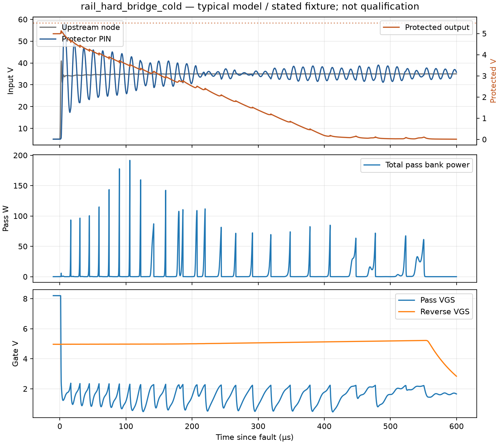
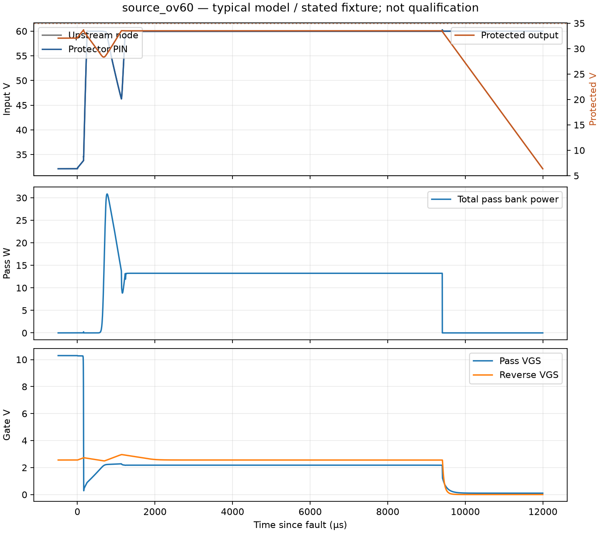

# Protection transient and MOSFET screening

2026-10-23. See the [selected circuits](../../design/rev_b_5v_recovery_protection_selection.md)
and [complete hardware contract](native_build_contract.md). **Development
screening passes its stated numerical checks; MOSFET survival and system
fault containment are not qualified.**

The [50 V bank follow-up](bank/README.md) records the installed converter bank and the original nuisance-latch discovery. The subsequent [latch/source-short and MOSFET follow-up](latch/README.md) is the current protection circuit/evidence; it supersedes the old timer/divider values and native BOM below. Historical screens do not establish acceptance of the revised circuit.

## Saved evidence

- [All 46 cases and numerical results](evidence/results.md),
  [machine-readable results/provenance](evidence/results.json).
- [Native electrical and rendered-sheet evidence](native/README.md): 81 parts,
  40 exact endpoint sets, direct CLI ERC 0 errors / 1 documented external-reset
  warning. S03 severity-setting and S11 presentation API limitations are
  explicit; page IDs remain inconsistent. These are separate from simulation.
- [Generator](run_protection.py), [fixtures/corners](cases.json),
  [independent raw-data collection and numerical checks](collect_results.py).

Two cases deliberately omit the rail guard and must **exceed** 5.5 V. Their
expected rejection is a passing check of a counterexample, not an accepted
protection circuit. Other “pass” checks cover provisional output ceilings,
external gate/drain limits, selected restart behavior and the stated package
case. They do not assert every rating, SOA, capacitor, magnetic or consumer
acceptance criterion.

## Principal results

| Fixture | Result |
|---|---|
| 60 V source fault, high FB sensitivity | VIN_CHG peak 34.7109 V versus provisional 35 V ceiling |
| Persistent 60 V source, 5.5 s | Approximately 120.0 mJ total pass-FET energy; remains disconnected; no sustained TVS absorption in this model |
| Safe source returns | Autonomous restart after cooldown; final 32.0643 V |
| Rail slow OV, high FB sensitivity | Shared output peak 5.4376 V versus provisional 5.5 V ceiling |
| Rail 10 mΩ / 10 nH bridge, −40 °C model, extra 1 µs sense delay | Output peak 5.1260 V; total parallel-pass-bank energy 3.711 mJ |
| Finite 330 µF / 35 V reservoir bridge, replenishment limited to 1 A | Output peak 5.1011 V; total pass-bank energy 2.854 mJ |
| Low converter-output corner, +85 °C model, 2 A load | Protected output 4.8073 V before stack wiring |
| Deliberate reset after source clears | Final rail output 4.9676 V; restores ≤0.5 A load during restart, then 2 A |
| Stiff step with no guard | 6.6598 V: rejected |
| Low-impedance bridge with no guard | 6.5290 V: rejected |

The source fixture is PV limited to at most 1 A, with 1 µF upstream reservoir
and 1 µH harness. These are engineering bounds requiring actual source
acceptance. The 2 A system-load estimate does not bound PV fault current.
Source retry is inhibited at nominal 36 V; the independent FB clamp has the
33.5 V nominal protected ceiling. A 60 V hot-plug remains off. Weak PV cases
below the commanded load do not establish successful charging or boot.

The rail fault fixtures include the upstream converter bank's effective
160 µF bulk / 24 µF ceramic, ESR/ESL, the separate guard's 2.5 µH / 10 mΩ
minimum-L sensitivity, and 2 µF at PIN. Protected-side minimum is 112 µF
bulk at 0.4 Ω ESR plus 48 µF ceramic at 2 mΩ; bulk/ceramic ESL are 5/1 nH.
The high-capacitance startup case is 551.2 µF, including external allocation.
The model does not reproduce the TPS552872 switching loop or every failure
topology. The guard remains linear in the simulation: hot minimum L through
the measured fault current is an **unclosed component requirement**.

The finite-energy fixture produces **38.23 V upstream of the guard**. This
exceeds the current converter study's 35 V bulk and 25 V ceramic ratings.
The downstream barrier does not protect that local bank. Rerating/clamping
the upstream bank and checking its changed impedance/fit remain integration
blockers. See the concrete 50 V bank option in the selection record.

## MOSFET and support-part survival assessment

Maximum external pass VDS in the selected fixtures is approximately 60.0 V
against 80 V; maximum external pass/reverse VGS is 11.70/10.29 V against
±16 V. The package-inductance source-short sensitivity gives internal gate
peaks of 10.30/10.83 V. These comparisons use typical transistor/controller
models and approximate TVS dynamics, not guaranteed hot limits.

The IRLR2908 datasheet Fig. 8 SOA and Fig. 11 transient thermal impedance
were actually inspected. Conservative hand-read constant-power comparison
levels over roughly 10–80 V are 1000 W / 100 µs, 200 W / 1 ms and
40 W / 10 ms at the plot's 25 °C case condition. A simple temperature-headroom
scaling to an assumed **85 °C case** gives 600/120/24 W. These levels are
graphical screening aids, not manufacturer tabulated limits or a proof for
arbitrary repetitive waveforms. Do not extrapolate the plot below its shortest
published pulse or accept parallel sharing without validation.

The 60 V source fault has an approximately 31 W initial peak followed by
about 13 W clamping for approximately 9 ms. The rail hard-bridge cold fixture
has 191.6 W total-bank peaks; aggregate time above 66.7 W is about 16.2 µs,
and above 16.7 W about 71.5 µs. Pulse bursts and their repetitions are visible
in the plots. Assigning all pass-bank power to one FET in the thermal
comparison gives approximately 5.1 K rise for that rail case and 13.8 K for
the source fault. Hypothetical fixed case temperatures of 85/125 °C therefore
give source junction comparisons near 99/139 °C. This **does not close hot
SOA**: the thermal network is hand constructed, excludes hotspot physics and
board/case heating, and is not a manufacturer electrothermal model.

The model with zero package inductance gives a 162 A reverse-device pulse
in a source short, above the 150 A pulsed body-diode rating. Adding the
datasheet's typical LD = 4.5 nH / LS = 7.5 nH reduces it to about 41 A.
This result makes measured package/loop behavior a requirement, rather than
proving that the zero-L counterexample can be ignored. The package case's
pass peak is about 372 W and lasts less than 0.1 µs above 333 W; its duration
is below the shortest published SOA curve. Hot pulse acceptance remains open.
Reverse-device energy is reported separately. Downstream capacitor discharge
also stresses the short path and receiving hardware; it is not all pass-FET
energy.

Support stresses include approximately 76 mA maximum PNP collector current,
0.58 W gate-discharge resistor peak, 17.1 W bias-resistor peak, 10.37 A / 2.71 mJ
maximum rail TVS pulse and 30.06 A guard-inductor peak. The latter drove
selection of **XAL1510-472MED**, replacing the smaller XAL1010. Its 39 A
typical 30% inductance-loss reference at 25 °C improves margin but does not
guarantee the modeled minimum at temperature. The selected snubber resistor
and sense shunts still need manufacturer pulse/derating acceptance; an energy
integral alone cannot close them. Gate TVS leakage/capacitance/temperature and
PNP gain/recovery must also be bounded.

## Reproduce

Requires Python 3.12+, NumPy and Matplotlib, and licensed/installed LTspice
26.0.2 macOS with its ADI LTC4364-1/-2 and standard.mos models. The encrypted
models are not redistributed. Their SHA-256 digests, circuit hashes and raw
waveform hashes are saved in results.json. The generator resolves model paths
from the user's LTspice library. Each run verifies a completed log and parses
the saved binary waveforms. Exact completed decks can be reused after an
interruption; do not run the macOS batch app concurrently.

```sh
python3 run_protection.py --work /absolute/scratch/protection
python3 collect_results.py --work /absolute/scratch/protection
python3 native/verify_native.py
```

Run from this directory; `--filter` on the generator selects a case-name
substring. Collection requires every case and rejects stale decks. Raw/log
files stay in the scratch directory. No simulation or collection script
modifies KiCad files. This run's scratch directory was
`/Users/nick/Documents/ChatGPT/EMBER/eps-rev-b-study/recovery-2026-10-23/protection-accepted`.

The simple BZT/TVS, diode and PNP approximations are explicitly declared in
the decks. Reference/divider sensitivities are not a guarantee at 5–12 V VCC:
the LTC4364 cited FB specification covers 12–80 V. Initial case temperature,
device sharing, parasitics, capacitance/ESR, nonlinear L and actual consumer
limits require independent evidence. No physical or battery test was run. Prose/scripts/export-data whitespace
checks pass; Konnect-generated tab-only blank lines in native schematics are
retained rather than edited outside Konnect.




