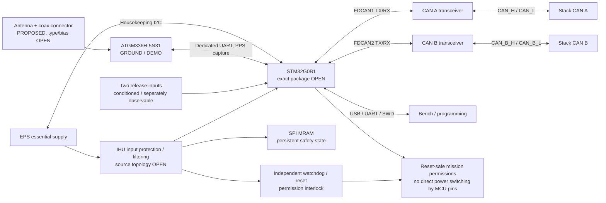

# IHU hardware requirements and electrical interface specification

**Draft 0.1 · October 24, 2026 · Design brief for Austin · Not a fabrication release**

[IHU hardware](../README.md) · [Interface summary](interfaces.md) ·
[Canonical stack pin map](../../../system/interfaces/cskb_pinmap.md)

## 1. What to design around

Design a **custom STM32G0B1-family IHU**, with **two native CAN controllers and
two separate CAN transceivers**, essential housekeeping/control power, persistent
state storage, independent watchdog/reset protection, programming/debug access,
and an **ATGM336H-5N31 GNSS module for ground/demo use**. RP2040/Pico is no longer
the processor direction for this PCB. Existing Pico/Feather hardware and the
Pico teaching UF2 remain separate test articles; they are not STM32 firmware.

This document defines the new design direction and collects unresolved electrical
contracts. It does not prove a completed circuit, MCU port, PCB layout or test.
An open value is a required engineering decision, not permission to guess it.

### Decision labels

| Label | Meaning | Austin's action |
| --- | --- | --- |
| **D — DECIDED** | Explicit user decision recorded October 24 | Preserve; implementation still needs checking |
| **C — EXISTING CONTRACT** | Direction inherited from an identified repository interface | Preserve unless a coordinated change is approved; conflicts are listed below |
| **P — PROPOSED** | Engineering recommendation in this draft | Use for planning; obtain review before freezing affected circuitry |
| **O — OPEN** | Missing selection, number, allocation or agreement | Track closure; do not claim the dependent design is released |

“Shall” describes the proposed design/verification obligation. It does not promote
P/O items into approved decisions. Requirements marked D/C preserve the stated
choice; component values and implementation details remain subject to review.

### At-a-glance design matrix

| Area | Baseline | Status | Still to close |
| --- | --- | --- | --- |
| MCU | STM32G0B1 family; two native FDCAN peripherals | **D** | Exact MPN/package, pin map and measured memory fit — O01 |
| Initial CAN operation | Two physically independent buses; classic CAN at 500 kbit/s | **C** | PHY selection, fault envelope, harness and failover — O04/O05 |
| GNSS | ATGM336H-5N31, ground/demo initially | **D** | Exact supplied variant/manual, power and integration — O08 |
| GNSS flight use | Not qualified by this selection | **O** | Orbital suitability and mission need — O09 |
| GNSS antenna | Reserve external RF connection; u.FL/I-PEX-type coax connector suggested | **P** | Connector MPN, antenna, bias and retention — O10 |
| Core power | Essential stack 3.3 V is the proposed normal source | **P** | Resolve older 5 V/Pico source plan; full input envelope — O02 |
| Persistent state | Dedicated SPI MRAM; MR25H40 is inherited candidate | **C/P** | Exact MPN, journal/update protection and electrical fit — O07 |
| Console/programming | Native USB CDC, separate 3.3 V UART, keyed SWD | **P** | Connector details, power isolation and boot recovery — O11 |
| Release sensing | Two independent conditioned inputs with test access | **P** | Switch owner, physical contacts, polarity and pins — O06 |
| Watchdog/reset | Independent supervision; reset must remove mission permissions | **C/P** | Watchdog part, hardware fanout and deadlines — O12 |
| Payload permission | `PAYLOAD_EN`, 3.3 V push-pull, default low | **C** | Source-drive proof, reset interlock and connector validation — O05/O12 |
| Board mechanics | Existing CSKB H1/H2 allocations retained | **C** | Exact outline, connectors, stack clearances and antenna access — O13 |

## 2. Architecture and ownership

IHU owns system mode/command authority. EPS owns energy distribution and
independent electrical protection. COMMS owns radio operation and local TX
suppression. Payload owns its local power/trigger sequence. A CAN message or
IHU GPIO is not, by itself, independent hardware protection.

**IHU-SYS-01 [C]:** Reset/hang behavior shall preserve essential recovery power
where healthy-source interlocks permit, while stopping payload mission work,
removing TX permission and leaving antenna burn inactive. Do not wire IHU NRST
to a stack-wide power/reset function as a shortcut. Exact enforcement circuits
and deadlines are O12; this requirement does not guarantee rail continuity
through a real source fault.

**IHU-SYS-02 [P]:** Optional GNSS/antenna faults shall be isolated sufficiently
that they cannot remove the IHU's essential control and recovery functions.
The GNSS is not an authority for release qualification or deployment delays.

## 3. MCU, memory and pin-allocation contract

### Parts already used in the design plans

| Board | Documented candidate | Meaning for this IHU |
| --- | --- | --- |
| EPS Rev B | **STM32G0B1KET6**, general-purpose LQFP32 | Same family; small-package pin budget is specific to EPS |
| Payload supervisor | **STM32G0B1VET6**, LQFP100 | Preferred IHU starting candidate for package/common-part review; not an approved IHU pin map |
| IHU new PCB | **STM32G0B1 with two FDCAN peripherals** | Family decided; exact order code remains **O01** |

See [EPS package study](../../eps/design/rev_b_pin_and_fit_study.md),
[EPS BOM direction](../../eps/design/rev_b_bom_and_schematic_checklist.md), and
[payload supervisor contract](../../payload_compute/design/supervisor_interfaces.md).
These are design selections, not proof of fitted EPS/payload MCUs.

**IHU-MCU-01 [D]:** Use native dual CAN controllers. Do not carry the old
MCP2515/MCP25625 external-controller architecture into this board. Each native
controller still requires its own external CAN physical-layer transceiver.

**IHU-MCU-02 [P]:** Prefer STM32G0B1VET6 as the first allocation study to match
payload; compare a smaller package only after all reservations fit. Verify exact
physical leads, alternate functions, supply domains, reset behavior, symbol and
footprint against [ST DS13560 Rev 6](https://www.st.com/resource/en/datasheet/stm32g0b1re.pdf).
Do not copy a pin map from another package or its alternative N pinout. The EPS
study reports a library/pinout mismatch; reuse requires fresh acceptance.

**IHU-MCU-03 [P]:** Budget the complete FreeRTOS port before freezing the MCU.
The family provides 144 KB SRAM; the recorded RP2040 0.15.0 candidate uses
133,796 BSS bytes in [the recorded FreeRTOS candidate](https://github.com/ngrabbs/ember/pull/41)
before a target-specific port is sized. That figure is a warning,
not a fit calculation. Include static tasks/stacks, ISR/main stack, CAN/USB/GNSS
buffers, NVM workspace, runtime/library allocations and measured margin. The
64 MHz core also requires execution/latency checks. Native CAN may remove old
controller/transport overhead; do not assume it removes enough RAM. If the
measured budget fails, revisit MCU selection with Nick rather than silently
reducing safety queues or supervision. Firmware porting is separate work.

**IHU-MCU-04 [P]:** Reserve the following functions before assigning physical
leads. Austin shall produce a conflict-free, versioned pin-allocation table with
peripheral instance, AF, physical lead, supply domain and reset state for each.

| Function reservation | Minimum planning allowance | Allocation status |
| --- | --- | --- |
| FDCAN1 and FDCAN2 | Four AF signals plus PHY mode controls | Reuse payload's PC4/PC5 and PB12/PB13 only as candidates after exact-part validation |
| EPS housekeeping I2C | SDA/SCL; alert input | Required; pins open |
| Dedicated GNSS UART | TX/RX plus PPS timer-capture input | Proposed; do not share console UART |
| GNSS management | Reset, optional shutdown/power control, power-good if selected | Proposed; O08 |
| SPI MRAM | SCK/MOSI/MISO/CS; hardware WP provision | Inherited storage; pins open |
| Console | Native USB D+/D− and separate UART TX/RX | Proposed; include VBUS-sense needs in allocation |
| Debug/reset/boot | SWDIO/SWCLK/NRST and validated boot recovery | Required design access; O11 |
| Release/configuration | Two independent release inputs and separate boot-latched test configuration | Proposed; physical semantics O06 |
| Watchdog | Feed, enable/valid observation as required by selected circuit | O12; do not assume a GPIO feed alone is protection |
| Stack controls/faults | PAYLOAD_EN; EPS/COMMS/payload status; retained legacy reservations | See §5; do not reuse occupied CSKB nets |
| Clocks/telemetry/reserve | HSE, optional LSE, rail/temperature measurements and spare test access | O01/O03/O13 |

**IHU-MCU-05 [P]:** Provide the exact part's decoupling, VDDIO2/analog/reference
connections, reset/boot networks and oscillator support following
[ST AN5096 Rev 4](https://www.st.com/resource/en/application_note/an5096-getting-started-with-stm32g0-mcus-hardware-development-stmicroelectronics.pdf).
Use an external HSE as the initial CAN clock proposal; frequency, tolerance,
capacitors and startup margin are O03. A working internal clock on another board
is not CAN timing evidence. RTC/backup power remains O07/O08.

## 4. Supply, drive levels and power-state behavior

### Supply worksheet — values required before freeze

| Domain | Starting point | Required closure |
| --- | --- | --- |
| Normal IHU core | Stack `+3V3`, H2.27/28, nominal 3.3 V | **P/O02:** continuous min/max, ripple/transients, current, fault isolation and startup sequence |
| MCU and CAN PHYs | Local branches from essential source | O02: selected parts' operating ranges, distribution drop and worst-case current |
| GNSS | Separate filtered/switchable branch proposed | O08: dropout headroom, noise, startup peak and antenna contribution |
| SPI MRAM / watchdog | Essential branch | O07/O12: valid write/reset thresholds and power sequencing |
| USB bench supply | VBUS input only if an explicit isolated power path is fitted | O11: no stack backfeed, no regulator-output contention, no implicit source change |
| Stack `+5V` | Existing H2.25/26 allocation preserved | O02: new IHU consumption not authorized by older Pico VSYS design |
| Stack `VBAT` | Existing H2.45/46; no IHU consumption assigned | **C:** do not connect raw spacecraft VBAT to MCU/GNSS backup pins |

**IHU-PWR-01 [P]:** Use 3.3 V logic as the starting interface domain. Propose
3.3 V ±5% at local digital loads for allocation only; this is not an accepted
EPS rail guarantee. Account separately for filters, switches, connectors, ground
offset and transients. The stack's provisional 2 A rail allocation is not the
IHU's current allowance. O02 must establish actual maximum and inrush budgets.

**IHU-PWR-02 [P]:** Produce a parts-based worst-case power table for core/USB,
both CAN PHYs, MRAM, watchdog, indicators, GNSS and antenna. Include simultaneous
active CAN, cold acquisition, antenna short, debug attached and brownout cases.
Use a current-limited bench supply during bring-up with its limit derived from
that table; no final bench current-limit number is approved yet.

**IHU-PWR-03 [P]:** A powered peer, UART adapter, SWD probe, USB host or GNSS
backup supply shall not phantom-power an unpowered IHU domain. Check Ioff,
injection-current limits, series protection/isolation and rail sequencing for
every crossing. A series resistor alone is not proof of partial-power safety.

### Electrical drive contract

| Interface | Driver / receiver | Required behavior / status |
| --- | --- | --- |
| `PAYLOAD_EN` | IHU → payload | **C:** 3.3 V push-pull, low at reset; meet connector VOH ≥3.0 V and VOL ≤0.4 V under agreed load |
| Open-drain fault inputs | Peer → IHU | **C/P:** EPS_ALERT_N, COMMS_FAULT_N, PAYLOAD_FAULT_N; one pull-up owner, power-off-safe receiver and defined missing-peer interpretation |
| Housekeeping I2C | Shared open-drain | **C:** pull-ups currently allocated to EPS; no automatic duplicate pull-ups on IHU |
| Console UART | IHU ↔ debug host | **P:** 3.3 V logic, 115200 8N1 initially; not RS-232 voltage levels |
| GNSS UART/PPS | MCU ↔ module | **P:** verify both directions against actual powered/unpowered domains; no 5 V signaling |
| CAN TX/RX | MCU ↔ local PHY | **P:** match selected PHY logic thresholds and reset defaults; these are not CANH/CANL wires |
| Physical CAN pairs | PHY ↔ stack | **C/P:** independent A/B; protection/common-mode envelope O04 |
| Release contacts | Mechanism/harness → input conditioner | **O06:** no flight pin voltage/polarity is frozen by the Pico demo |

For every driver/receiver pair, supply a signed worksheet with VOH/VOL at load,
VIH/VIL, leakage, pull network tolerance, ground offset, edge rate and powered-off
case. Include RC conditioning in timing. Nominal “3.3 V compatible” is insufficient.

The [payload permission circuit](../../payload_compute/design/permission_control.md)
allocates a receiver-side pulldown and loading. Verify the new STM32 output or
buffer can meet that connector guarantee at minimum supply and maximum loading.
Do not add an AON pull-up to PAYLOAD_EN. Normal shutdown and immediate kill are
different operations; preserve the payload's bounded stop/permission contract.

## 5. Stack electrical interface and CAN

**IHU-IF-01 [C]:** Preserve the canonical external names and assignments below.
The table allocates board interfaces, **not MCU leads**. New signals need an
explicit canonical pin-map update before routing. No firmware-only choice can
reassign an occupied connector pin.

| CSKB pin(s) | Canonical net | IHU direction | Contract / action |
| --- | --- | --- | --- |
| H2.27/28 | `+3V3` | Supply input candidate | Normal essential-source proposal; close O02 |
| H2.25/26 | `+5V` | Existing supply reservation | Resolve new use explicitly; do not join to 3.3 V |
| H2.29/30/32 | `GND` | Return | Connector/harness current and reference review |
| H2.31 | `GND` in current map / Pumpkin AGND | Return, topology unresolved | Existing map's star-ground language needs reconciliation; no new ground-domain short authorized |
| H1.51/52 | `CAN_H` / `CAN_L` | Bidirectional CAN A | Primary pair; connector-to-connector verification required |
| H2.49/50 | `CAN_B_H` / `CAN_B_L` | Bidirectional CAN B | Separate redundant pair; do not tie to A |
| H1.41/43 | `I2C_SDA` / `I2C_SCL` | Bidirectional | EPS-side pull-ups; initial 100 kHz, 400 kHz only after qualification |
| H1.49 | `EPS_ALERT_N` | Input | Existing charger alert; Rev B MCU alert semantics require coordinated update |
| H1.19/20 | `UART_DBG_RX` / `UART_DBG_TX` | Input / output | Retain stack reservation; local header may expose same UART with loading review |
| H1.47 | `COMMS_EN` | Output reservation | Power-enable semantics unresolved; not a new RF arm line |
| H1.48 | `COMMS_FAULT_N` | Input | Open-drain contract; IHU pull-up ownership |
| H1.50 | `PAYLOAD_EN` | Output | Default-low permission; §4 and §7 |
| H2.47 | `PAYLOAD_FAULT_N` | Input | Open-drain fault contract; validate updated AON payload behavior |
| H2.48 | `PAYLOAD_SLEEP_REQ_N` | Legacy output reservation | Do not connect new payload blindly; O05 resolves retained/unused function |
| H1.16 | `COMMS_IRQ` | Legacy input reservation | Old SPI data-ready function; optional/unused under CAN pending O05 |
| H1.21–24 | `SPI_COMMS_SCK/MISO/MOSI/CS_N` | Legacy reservations | Not the new packet path; do not repurpose for local MRAM |
| H1.29 / H1.42 | `SYS_RESET_N` / `VBACKUP` | Reserved | No new stack reset or backup drive authorized |
| H2.45/46 | `VBAT` | No IHU connection allocated | Raw battery; retain separation from local backup pins |

**IHU-CAN-01 [D/C]:** Populate two PHY paths connected to the native controllers.
Initial wire operation shall remain classic CAN at 500 kbit/s, FD disabled, so
existing peers remain interoperable. FDCAN capability does not authorize FD on
the mixed network. Preserve current protocol/identity separation during porting.

**IHU-CAN-02 [P]:** Evaluate **TCAN334GDR**, matching payload's candidate, or an
approved equivalent. Select exact MPN after checking supply, bus faults,
powered-off bus loading and mode controls. Each channel needs independent
standby/shutdown management as supported by its PHY, recessive reset behavior,
connector-side protection and observation points. CAN common ground and PHY
protection are required; galvanic isolation is an open trade, not implied.

**IHU-CAN-03 [C/P]:** Provide selectable/DNP endpoint termination on each bus;
fit 120 Ω only at the two physical endpoints of that particular bus. A/B topology,
stub length, harness impedance and fault testing are O04. A controller's bus-off
recovery must not replay payload or deployment commands. A/B shares MCU/power;
it does not provide independent controller-level fault tolerance.

**IHU-IF-02 [O05]:** Existing documents are not a reconciled assembly harness.
The October 23 local interconnect review reports CAN connector conflicts across
board exports. That drawing is not yet on this branch. Re-export each intended
board revision and close the conflict against the canonical map before wiring.
Also reconcile legacy COMMS_EN, SPI/IRQ, payload sleep and EPS alert semantics.
This spec preserves names; it does not certify current connector compatibility.

## 6. GNSS and antenna subsystem

**IHU-GNSS-01 [D]:** Include **ATGM336H-5N31 for ground/demo initially**.
The manufacturer uses the spelling `ATGM336H-5N-31` in its family documentation;
confirm exact orderable suffix, hardware/firmware revision and approved footprint
before purchasing/capture. Family capabilities do not establish every variant's
constellations or electrical behavior.

**IHU-GNSS-02 [P]:** Use a dedicated bidirectional UART and reserve PPS to a
hardware-capture-capable MCU pin. Initial settings are 9600 baud, 8N1, NMEA,
1 Hz output, subject to exact variant confirmation. PPS alone is not valid UTC;
firmware must associate time messages, fix/time validity, age and uncertainty.
Keep monotonic release/deployment waits independent of GNSS acquisition or jumps.
Do not add a new stack PPS pin without a system allocation.

**IHU-GNSS-03 [P]:** Provide a quiet, separately controllable power branch and
probe access. The manufacturer specifies a 2.7–3.6 V supply; its manual lists
100 mA peak excluding antenna and recommends ripple below 50 mVpp. Budget peaks,
not just nominal tracking current. A 3.3 V LDO fed by a nominal 3.3 V stack rail
may lack headroom: close source/filter/regulator topology under O08. Prevent
UART/PPS from back-powering either switched domain.

**IHU-GNSS-04 [P/O08]:** Plan reset/shutdown access and a deliberate backup-power
choice. No coin cell or spacecraft VBAT connection is approved. Separate local
backup naming from the existing stack `VBAT`. Retaining backup time does not
make it trusted mission time after power loss. Confirm all reserved pins and
recommended unused-pin handling from the supplied module's manual.

### Antenna proposal — not yet a selected assembly

**IHU-RF-01 [P/O10]:** Reserve one coax antenna connector near the module's RF
input and board edge. A **u.FL/I-PEX-type connector with a retained pigtail** is
the initial space-saving proposal; SMA is an alternative if access/retention and
clearance favor it. Select the actual connector/antenna MPNs together. Similar
micro-coax connectors are not assumed mechanically interchangeable.

**IHU-RF-02 [P]:** Plan a 50 Ω RF route with continuous return and the selected
connector's launch geometry. Width/gap depend on the approved stackup; do not
assign geometry from a generic drawing. Keep the module/antenna away from CAN,
USB, MCU clocks and power-switching noise. Check pigtail bend radius, strain
relief, assembly height, antenna placement and enclosure/sky visibility.

**IHU-RF-03 [O10]:** Choose active versus passive antenna before completing the
RF circuit. The manufacturer's active-antenna example uses VCC_RF through a bias
network; its passive example includes an external LNA. Review the actual
application circuit, bias current, RF protection/capacitance and grounding.
Do not connect an external 5 V antenna supply or assume a passive patch works
with the active-antenna circuit. Budget/contain antenna shorts without losing
essential IHU power. Optional unpopulated alternatives must have explicit assembly
variants; do not connect two unterminated RF paths in parallel.

**IHU-GNSS-05 [D/O09]:** Ground/demo use is approved direction; flight suitability
remains open. The older manufacturer manual lists 18,000 m and 515 m/s limits.
These do not establish orbital operation. Obtain variant/firmware-specific vendor
evidence and mission-relevant testing before using this receiver for orbital
position or time. Retain the ability to depopulate/isolate the ground/demo GNSS
branch; a flight alternative requires a separately reviewed interface change.

Sources: [manufacturer product page](https://www.icofchina.com/daohang/danpin/2525.html)
and [manufacturer ATGM336H-5N manual v1.2, July 15, 2016, distributor-hosted copy](https://atta.szlcsc.com/upload/public/pdf/source/20161226/1482720799860.pdf),
§§2.4–2.8, pp.10–14. These sources are a starting reference, not confirmation of
an ordered module's current specification. No GNSS flight performance is claimed.

## 7. Release inputs, configuration, persistent state and supervision

**IHU-REL-01 [P/O06]:** Reserve two separately observable, conditioned release
inputs and a keyed local test connector. Establish whether EPS senses physical
contacts and reports them, IHU senses dedicated contacts, or independent qualified
contacts go to both. Do not parallel an IHU pull-up into an EPS/RBF power-inhibit
circuit or treat software sensing as a physical flight inhibit.

**IHU-REL-02 [P]:** Specify contact sense current, open/closed voltage thresholds,
bias owner, filtering/debounce, ESD, harness length, return, open-wire/short handling
and logging for each input. “Both qualified” is the initial software proposal;
polarity, flight dwell and behavior after reinsertion remain O06. Pico demo GP14/
GP15, ground-to-hold and 250 ms debounce are demo settings, not production pins
or approved launch requirements. Reserve a separate boot-latched GROUND_TEST/
FLIGHT configuration input with a restrictive unknown state.

**IHU-NVM-01 [C/P]:** Preserve dedicated SPI MRAM in the design direction; the
older IHU guide proposes **MR25H40**. Confirm its full order code, voltage,
capacity, WP/HOLD behavior, decoupling and supply-loss writes. Keep it board-local,
with idle CS inactive and no shared stack-SPI exposure. Reserve independent
critical journal and noncritical event capacity; define updater/debug erase rules.
MRAM retention is not atomic multi-field commit or a trustworthy boot history.
Exact record format, commit proof and backup/repair policy are O07.

**IHU-WD-01 [C/P/O12]:** Include independent watchdog/reset supervision with
visible reset cause and conditioned release. Hardware shall remove mission
permissions during MCU reset or hang even when firmware cannot send a stop.
No timer/DMA-only feed is sufficient. TPS3431 from payload is a candidate; the
old IHU STWD100 selection is historical, not a drop-in circuit approval. Validate
feed/enable thresholds, WDO behavior when disabled, NRST fanout, startup window,
BOR and debug reset. A bench disable must also inhibit mission outputs.

**IHU-WD-02 [C/O12]:** Keep COMMS recovery/receive power distinct from TX
permission. A reset-safe TX-off path must not require cutting all COMMS power.
Burn outputs stay inactive and independently time-bounded. Ownership, connector
allocation and enforcement may be on COMMS/EPS; no new IHU burn MOSFET, RF pin or
stack assignment is approved here. Payload must distinguish always-on supervision
from mission-load power. Local expiring grants and bounded shutdown complement,
rather than replace, hardware interlocks.

### Reset and power-state truth table to implement and verify

| Condition | Required functional outcome | Electrical implementation status |
| --- | --- | --- |
| IHU reset/BOR or watchdog reset | Payload mission permission low; TX permission absent; burn off; recovery power preserved where protected sources permit | O12: circuit/receiver/fanout proof |
| IHU hangs without reset | Peers expire grants; independent output limits act without an IHU stop message | O12: deadlines and independent enforcement |
| IHU off, payload/COMMS on | No phantom power; no permission inferred from a floating input | O02/O05/O12: power-off IO and receiver bias |
| EPS restarts, IHU stays powered | IHU enters SAFE on detected EPS session loss/restart; no deliberate IHU reboot; fresh qualification required | O05/O12: session/timeout and rail continuity evidence |
| GNSS or antenna fails | Report invalid position/time; preserve monotonic timers and essential IHU operation | O08/O10: branch isolation and firmware behavior |
| Bench debugger/USB attached | Defined source selection; no stack backfeed or flight inhibit bypass | O11/O12: isolation and assembly interlock |

These are behavior obligations, not claims that connector pins or circuits already
implement them. The output-disable path must remain effective before application
initialization and under debugger reset/halt, not merely after a GPIO write.

## 8. Programming, console, mechanics and design deliverables

**IHU-DBG-01 [P/O11]:** Provide a keyed Cortex SWD connector with VTref, grounds,
SWDIO, SWCLK and NRST. VTref senses board voltage; default probe attachment shall
not power the board. Fit a reset button and accessible boot-recovery provision
validated against the exact MCU boot options/ROM support. Recovery shall not
require functioning application firmware.

**IHU-DBG-02 [P]:** Provide native USB full-speed CDC for the familiar console,
plus a clearly labeled 3.3 V UART TX/RX/GND header for recovery/umbilical use.
Choose USB connector, ESD and VBUS sense/power topology under O11. USB-C requires
correct sink detection even if the port is data/debug only. Console absence
shall not stall housekeeping or safety supervision. STM32 firmware loading is
not Pico BOOTSEL/UF2; create a new ST-LINK/CubeProgrammer procedure with the port.

**IHU-MECH-01 [C/P/O13]:** Use the canonical CSKB mounting/connector authority,
not an invented rectangle or a picture of another board. Confirm IHU endpoint/
stackthrough choice, mounting holes, board-to-board spacing, top/bottom heights,
access and antenna coax retention. Four layers is a planning recommendation;
layer count, stackup, impedance and fabrication constraints require review.
Reserve test points for supply domains, reset/watchdog, both CAN pairs and PHY
logic, release inputs, configuration, permission, GNSS UART/PPS and MRAM CS.

Austin's schematic package shall include the full pin allocation, power table,
interface-drive worksheets, reset/power-state truth table, BOM with exact MPNs,
assembly variants and all remaining decision IDs. Use the repository's schematic
policy and net conventions; do not rename legacy stack nets during this migration.
Schematic review and PCB layout/fabrication approval are separate gates.

## 9. Decision register and freeze gates

Suggested reviewers below identify needed disciplines; they are not assignments
or evidence of approval. Close each item with date, decision, evidence and affected
requirements. No item is closed just because a footprint was placed.

| ID | Still to decide / demonstrate | Suggested reviewers | Gate blocked |
| --- | --- | --- | --- |
| **O01** | Exact STM32 MPN/package; complete AF/lead map; firmware flash/RAM/CPU budget and margin | Austin + IHU firmware lead | MCU/pin freeze |
| **O02** | 3.3 V versus older 5 V source architecture; input envelope, ground topology, peak/inrush/current limit, protection and fault isolation | EPS + Austin | Power schematic freeze |
| **O03** | HSE frequency/tolerance and parts; CAN clock/error budget; any LSE/RTC support | Firmware + Austin | Clock/MCU freeze |
| **O04** | CAN PHY MPN, logic/mode/reset behavior, bus-fault envelope, harness topology, termination and A/B failover | Comms/EPS/payload + Austin | CAN schematic and harness release |
| **O05** | Actual revision-specific connector reconciliation; COMMS_EN/TX separation; payload sleep/fault and EPS alert semantics | All board leads | Inter-board wiring release |
| **O06** | Physical release-switch owner/contact allocation, conditioning, connector/polarity, test configuration and launch timing | EPS + IHU + mission/mechanism lead | Release/inhibit circuit freeze |
| **O07** | MRAM exact MPN, voltage/write envelope, capacity/layout, atomic journal/update protection, RTC/backup policy | IHU firmware + Austin | Storage/backup freeze |
| **O08** | GNSS ordered variant, UART/PPS levels, power/noise/headroom, reset/shutdown and backup circuit | IHU + Austin | GNSS schematic freeze |
| **O09** | Mission need and approved orbital receiver/firmware evidence; current module is ground/demo only | Mission + GNSS reviewer | Flight GNSS acceptance only |
| **O10** | Antenna active/passive, gain/bias/current, connector MPN, pigtail/retention and RF stackup | RF + mechanical + Austin | Antenna circuit/layout freeze |
| **O11** | USB/UART/SWD connectors and source isolation; ROM recovery/boot options; tool/update manifest | IHU firmware + Austin | Debug/power schematic freeze |
| **O12** | Independent watchdog/reset/output enforcement; exact part, thresholds, startup/expiry/cutoff deadlines and bench bypass | All control/power leads | Safety schematic freeze |
| **O13** | Authoritative outline/stack heights, connector mating, board stackup, thermal/environment targets and qualification | Mechanical + Austin + mission | PCB/fabrication release |

**Can start now:** block diagram, parts/library research, full MCU allocation,
power estimates, connector comparison and clearly marked draft schematic blocks.
**Before schematic freeze:** resolve O01–O08 and O10–O12 for populated paths.
**Before PCB release:** resolve O13 and all remaining electrical/layout blockers;
confirm O09 is either qualified or explicitly excluded by the flight assembly.
No routing or fabrication approval is granted by this document.

## 10. Verification matrix — no results claimed

| Check | Requirements | Acceptance evidence required |
| --- | --- | --- |
| MCU/package/library | MCU-01–05 | Exact-MPN AF/lead/supply audit; memory/latency report; library-to-pad check |
| Power and source combinations | PWR-01–03, SYS-01–02 | Worst-case table and measured startup/current/ripple; USB/stack/peer partial-power tests |
| Logic drivers and inputs | IF-01–02, §4 drive contract | Loaded VOH/VOL/VIH/VIL worksheet and measurements, including unpowered peers |
| CAN A and CAN B | CAN-01–03 | Each bus alone, termination, bus-off/fault isolation, mixed peers and no replay on failover |
| Release/configuration | REL-01–02 | Each contact, bounce, open/short/noise, reset and configuration-latching tests; physical-inhibit review separately |
| GNSS/antenna | GNSS-01–05, RF-01–03 | Exact variant identity, UART/PPS validity, acquisition/no-fix, cold-start peak, power-off IO and antenna short/open tests |
| Durable state | NVM-01 | Power interruption during writes/updates; reset cannot erase safety restrictions or replay an uncertain action |
| Reset/watchdog/permissions | SYS-01, WD-01–02 | Hung firmware, reset, brownout and disabled-watchdog truth table; scope traces of reset-safe outputs |
| Programming/console | DBG-01–02 | Cold programming/recovery, absent/disconnected terminal, connector polarity and no backfeed |
| Assembly/PCB | MECH-01 | Mechanical stack review; schematic ERC/connectivity and rendered-sheet review separately; PCB DRC and electrical measurements later |

Requirement identifiers in this table use the common `IHU-` prefix defined above.
Test numerical limits must come from the closed decision register, not from a
passing test's observed value. No ERC, rendered-sheet, physical or flight
acceptance is claimed by this documentation pass.

## 11. Authority, superseded assumptions and references

This specification changes the **new IHU PCB processor direction** and adds a
**ground/demo GNSS feature**. It does not change COMMS's MCU, EPS/payload hardware,
existing bench firmware, packet IDs, the Pico demo UF2 or canonical connector pins.

The [older Altium/Pico construction guide](altium_ihu_schematic.md) is historical
for MCU, external CAN controllers, source power and GPIO allocation. Do not build
that Pico design and substitute an STM32 symbol. Re-engineer the core, power,
clock, boot/debug, native CAN and reset circuits from the selected-part references.

The October 23 operational/recovery draft reviewed in the primary workspace is
not yet committed on `main` as of this document's base `06680f3`. This spec records
its reset/permission and MRAM direction without pretending those unmerged draft
requirements are implemented or all their timing values approved. The committed
[operations index](../../../docs/architecture/operations/README.md) remains the
entry point; reconcile it when the detailed operational specification is merged.

Manufacturer references checked October 24, 2026:

- [ST STM32G0B1VE product authority](https://www.st.com/en/microcontrollers-microprocessors/stm32g0b1ve.html),
  [DS13560 Rev 6](https://www.st.com/resource/en/datasheet/stm32g0b1re.pdf), and
  [AN5096 Rev 4](https://www.st.com/resource/en/application_note/an5096-getting-started-with-stm32g0-mcus-hardware-development-stmicroelectronics.pdf).
  Check current exact-part errata before acceptance.
- [ATGM336H-5N manufacturer page](https://www.icofchina.com/daohang/danpin/2525.html)
  and [manufacturer manual v1.2, distributor-hosted](https://atta.szlcsc.com/upload/public/pdf/source/20161226/1482720799860.pdf).
- [Payload supervisor/PHY/watchdog references](../../payload_compute/design/supervisor_interfaces.md),
  [payload permission electrical contract](../../payload_compute/design/permission_control.md),
  [stack power interfaces](../../../system/interfaces/power_interfaces.md), and
  [canonical CSKB map](../../../system/interfaces/cskb_pinmap.md).

| Revision | Change | Approval state |
| --- | --- | --- |
| 0.1 · 2026-10-24 | STM32 dual-native-CAN direction; ground/demo ATGM336H-5N31; electrical contracts, open decisions and verification gates | MCU family and GNSS ground/demo intent decided by Nick; remaining proposals/closures require review |
